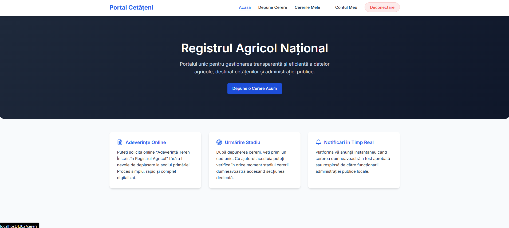
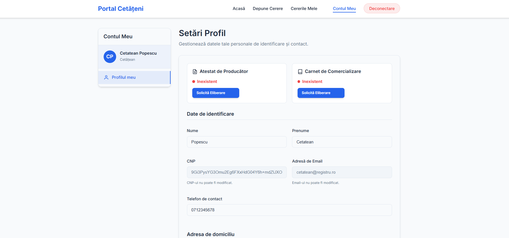
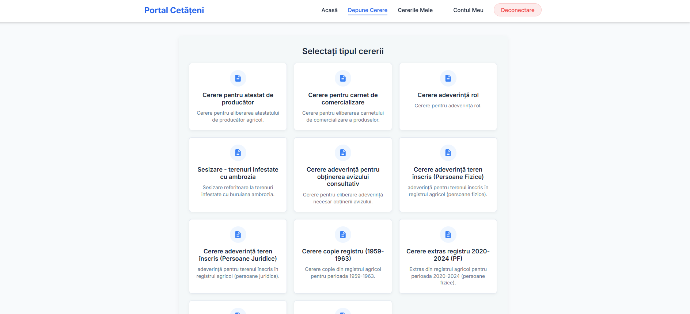
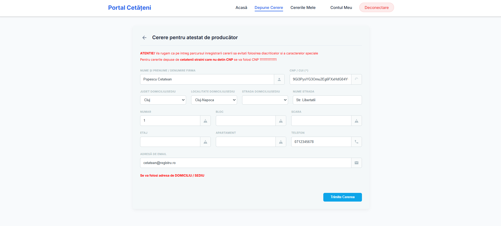
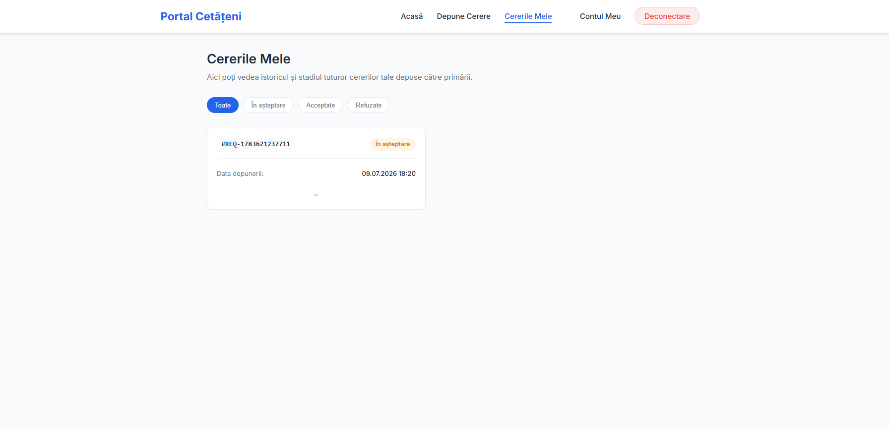

# Citizens Portal

[Documentation index](../README.md) · [Institutions Portal](Public-Institutions-Portal.md) · [Application workflow](../Workflows.md#citizen-application-to-institutional-response)

The Citizens Portal is the independent Angular application in [`src/portal-cetateni`](../../src/portal-cetateni). It lets citizens and legal entities register accounts, submit administrative applications to a locality, and follow institutional decisions. It does not expose the agricultural record editing interface used by public institutions.

This guide describes source inspected on 25 November 2026. “Implemented” means the UI and corresponding source operations exist; runtime, deployment, and authorization limits are stated where relevant. Historical proposals for ROeID, annual declarations, and automatic household access remain in the [historical specifications](../Historical/BusinessAnalysis/PortalCetateni.md).

## Application structure and navigation

| Route | Component | Behavior and access |
| --- | --- | --- |
| `/` | `Home` | Public service landing page; static explanatory cards and application call to action |
| `/login` | `Login` | Citizen email/password login |
| `/register` | `Register` | Physical-person or legal-entity account registration |
| `/cereri` | `Cereri` | Two-step service selection and submission; `AuthGuard` |
| `/cereri-mele` | `CereriMele` | Personal application history; `AuthGuard` |
| `/stadiu` | `Stadiu` | Public application tracking by code and UAT |
| `/contul-meu` | `ContulMeu` | Profile, attestation/booklet status, live contract notifications; no route guard |
| Unknown path | Router redirect | Redirects to the landing page |

Source: [routes](../../src/portal-cetateni/src/app/app.routes.ts), [application configuration](../../src/portal-cetateni/src/app/app.config.ts), [root component](../../src/portal-cetateni/src/app/app.ts).

The standalone Angular 21.2 application uses FormsModule, CommonModule, RxJS, and HttpClient configured with Fetch and a credentials interceptor. It has independent `package.json`, `angular.json`, Dockerfile, proxy, and Nginx configuration. Its root template is `app.component.html`; the similarly named `app.html` is not the template selected by `App`.

The navigation changes with the cached citizen session: authenticated users see “Depune Cerere,” “Cererile Mele,” “Contul Meu,” and logout; guests see login and public status tracking. The home screen is a **static landing page**, including service, tracking, and notification cards. It does not calculate personal dashboard totals or aggregate application metrics.

## Authentication and access

### Account registration

`Register` submits JSON to `POST /api/public/cetatean/register`. The data includes:

| Group | Fields and behavior |
| --- | --- |
| Account type | `tipPersoana`: `FIZICA` or `JURIDICA`; legal entities use company name and omit first name |
| Identity | `nume`, physical-person `prenume`, `cnp` (the shared account field also represents a legal entity's CUI) |
| Credentials | `email`, `parola`; confirmation password is compared in the UI |
| Contact | `telefon` |
| Address | `judet`, `localitate`, `strada`, `numar`; optional `bloc`, `scara`, `etaj`, `apartament` |

The UI requires identity, email, telephone, matching passwords, and the main address fields. The template gives legal identifiers a 2–20 character range, but `onSubmit()` unconditionally requires **13 characters**. Legal-entity registration is therefore partially inconsistent. This is a length check, not a mathematical CNP/CUI checksum verification.

The backend uses Bean Validation on `CetateanSignupRequest`, rejects duplicate email or identifier-hash matches, requires first name for a physical person, hashes passwords with BCrypt, and saves to `public.cetateni`. There is no email activation link, external identity verification, MFA, account approval queue, or password reset/change workflow in this application. A successful registration redirects to login after a short success message; it does not automatically sign in.

### Login, persistence, and logout

1. `Login` checks that email and password are present and calls `POST /api/public/cetatean/login`.
2. `CetateanAuthController` finds the citizen account by email and compares the BCrypt password hash.
3. The server issues a signed JWT with `userId`, subject email, and `type=CETATEAN`; it has no institutional tenant or role claim.
4. The token is stored in the `jwt_cetatean` HttpOnly, SameSite=Lax cookie, configured with a 24-hour age and `secure(false)` in current code.
5. The frontend caches identity metadata under `cetateanUser` in localStorage and publishes it through a `BehaviorSubject`. The JWT is not stored in that localStorage record.
6. On service construction, `checkSession()` revalidates the cached user against `GET /api/public/cetatean/me`, clearing local identity after failure. The interceptor uses `withCredentials: true`.
7. Logout posts to `/api/public/cetatean/signout`, expires the citizen cookie, clears identity, and returns to `/`, including when the logout request fails.

Invalid credentials produce a dedicated error; connection/server failures and other errors receive separate UI messages. The guard records a `returnUrl`, which login uses after success. Because session revalidation is asynchronous and the guard initially reads cached state, the guard is a navigation aid rather than the source of authorization.

### Server boundary

Spring permits `/api/public/**` at the HTTP security layer. Profile reads/updates, personal history, attestation status, and citizen PDF access perform their own principal/ownership checks. Application submission and public tracking do **not** require a citizen principal on the server. Submission attaches the authenticated citizen ID when available. The guard on `/cereri` does not change that API behavior.

Citizen accounts and institutional `User` records are separate identities. A portal account does not automatically create a household membership or authorize institutional record editing. [Security implementation and limits](../Backend.md#authentication-and-authorization).

## Profile and account information

`ContulMeu` loads `GET /api/public/cetatean/me`, then status from `/api/public/atestate/my-status`. It provides:

- Editable surname/company name, physical-person first name, phone, county/locality, street/number, and optional apartment details.
- Read-only CNP/CUI and email. The update payload does not include either, account type, or password.
- County/locality dropdowns populated from the bundled `UATS` dataset, with locality choices refreshed after county changes.
- Save state, required-field feedback, success notification, and profile loading/saving error messages.
- Producer attestation and commercialization booklet cards showing existence, application status, identifiers, and available dates supplied by the status endpoint.

The backend checks a citizen principal and reloads the account by ID for profile operations. The absence of a guard on `/contul-meu` can show a loading error to guests; it does not grant profile access.

The supplied screenshot displays an opaque identifier value. It captures an existing UI state and should not be interpreted as proof of successful identifier decryption. The converter's legacy-value fallback is explained in [backend documentation](../Backend.md#identifier-protection-and-audit).

Source: [profile component](../../src/portal-cetateni/src/app/pages/contul-meu/contul-meu.ts), [citizen authentication controller](../../src/backend/src/main/java/com/multitenant/controller/CetateanAuthController.java).

## Administrative service catalog

The first step of `/cereri` presents cards defined in `tipuriCereri`. Selecting one records `tipCerere`, its display title, and advances to the shared form.

| Application type (API value) | Service presented to the citizen |
| --- | --- |
| `ELIBERARE_ATESTAT_PRODUCATOR` | Producer attestation (*atestat de producător*) |
| `ELIBERARE_CARNET_COMERCIALIZARE` | Agricultural product commercialization booklet |
| `ADEVERINTA_ROL` | Agricultural role/register certificate |
| `SESIZARE_AMBROZIA` | Report of ragweed-infested land |
| `ADEVERINTA_AVIZ_CONSULTATIV` | Certificate supporting a consultative endorsement |
| `ADEVERINTA_TEREN_PF` | Registered-land certificate for physical persons |
| `ADEVERINTA_TEREN_PJ` | Registered-land certificate for legal entities |
| `COPIE_REGISTRU_1959_1963` | Copy from the 1959–1963 agricultural register |
| `EXTRAS_REGISTRU_PF` | 2020–2024 register extract for physical persons |
| `EXTRAS_REGISTRU_PJ` | 2020–2024 register extract for legal entities |
| `ADEVERINTA_DETINERE_TEREN` | Certificate of land holding/non-holding |

The historical year ranges are literal labels in the source, not automatically updated reporting periods. The backend enum additionally contains `GENERALA`, which is not an extra catalog card.

The catalog is a local list, not a searchable backend service marketplace. Institution selection is **county + locality/UAT**, not a separately implemented public-institution directory. The form's bundled UAT identifiers must correspond to `public.uats` on the backend; listing a locality in the static dataset does not establish that a tenant has been provisioned for it.

The UI blocks selecting an attestation/booklet when the global status flags say the account already holds one. This is a client-side convenience; `createCerere` does not independently enforce a duplicate-application/eligibility rule. Legal eligibility, payment, appointment booking, and external approval are not established by the catalog.

## Application creation and submission

### Form and validation

The shared form captures `nume`, `cnpCui`, address, telephone, email, optional land-book/cadastral references, `uatId`, and the selected type. It prefills identity/contact/address from the citizen profile. County and locality are selected from the bundled UAT data. Address parts are assembled into the `domiciliu` string before posting.

The template marks name, identifier, county, and UAT as required. The submit button explicitly disables submission while saving or when name, identifier, or UAT is missing. The optional address details, telephone, email, land-book number, and cadastral number enrich the application; this is not a different domain form for each service. Validation is not a complete administrative eligibility check. The application controller does not annotate its DTO with `@Valid`; invalid application types may ultimately reach persistence constraints.

There is **no file attachment input or multipart HTTP request for submitting an administrative application** in the Citizens Portal. Institutional household document storage is a separate workflow.

### Processing and confirmation

1. The browser posts the assembled JSON to `/api/public/cereri` and shows a submitting state.
2. The controller attaches citizen `userId` when authenticated, looks up the public UAT by numeric ID, and selects its tenant context.
3. `CerereService` maps the DTO, explicitly converts `tipCerere`, sets `PENDING`, and generates `cerere-` plus the first eight characters of a UUID.
4. The application is saved in the selected tenant schema; the code is returned to the form and shown as confirmation.
5. The backend publishes the application to the tenant application WebSocket topic and attempts a Thymeleaf/SMTP confirmation email when an email was supplied.
6. Failure displays a retry message. A success without a code has a separate warning. Email failure is caught and does not intentionally undo the saved application.

Email sending is **synchronous** in the source (`JavaMailSender.send`, no `@Async`). The historical mail report calls it asynchronous; that description is preserved as history and corrected here. The email includes the applicant name and tracking code. Status decisions currently use WebSockets, not a separate status email implementation.

Source: [application component](../../src/portal-cetateni/src/app/pages/cereri/cereri.ts), [controller](../../src/backend/src/main/java/com/multitenant/controller/CerereController.java), [service](../../src/backend/src/main/java/com/multitenant/service/CerereService.java), [email service](../../src/backend/src/main/java/com/multitenant/service/EmailService.java).

## Personal application history and document retrieval

`CereriMele` calls `/api/public/cereri/my-cereri`. The server requires a citizen principal, enumerates distinct tenants assigned to global UATs, selects each context, and gathers applications with that citizen `userId`. This is a backend aggregation across tenant schemas, not a direct connection between the frontends.

The page sorts newest-first, normalizes array-format timestamps when necessary, and offers four local filters: all, `PENDING`, `ACCEPTED`, and `DECLINED`. It paginates six applications per page and expands a selected card's details, including available cadastral/land-book references. Loading, empty, and retrieval-error states are present.

Accepted applications expose PDF download through `/api/public/cereri/{id}/pdf`. The controller checks ownership and accepted status, selects a specific attestation/booklet/role template or generic template, and returns `application/pdf`; the frontend opens the blob in a new tab. Generation is on demand rather than a citizen-uploaded attachment.

**Current limitation:** the PDF controller searches tenant-local IDs in sequence and stops at the first match before its ownership check. IDs can collide between schemas; the history UI sends only the numeric ID. Document retrieval therefore needs additional tenant disambiguation for reliable multi-tenant behavior. The institutional PDF role branch also differs from permissions for processing applications. [Implementation status](../Implementation-Status.md).

There is no citizen edit, cancellation, resubmission action on an existing application, free-text institution response, rejection explanation, or application-attachment download. The institutional response is principally the status change and, on acceptance, generated document availability.

## Public tracking

`/stadiu` remains accessible without login. The visitor selects county/locality, enters the application code, and calls `GET /api/public/cereri/{codCerere}?uatId=...`. The backend resolves the selected UAT's tenant, looks up the code, and returns the application DTO or 404. The UI reports a generic “not found; check code and locality” message for failures.

After a successful lookup, the page subscribes to `/topic/cereri/{codCerere}` and replaces displayed details on updates. A new search disconnects the old socket; component destruction deactivates it. The endpoint returns the DTO rather than a minimal public-status projection. Treat the code-based access model according to its actual implementation, not as verified confidential account access.

## Communication and notifications

| Mechanism | Trigger, destination, and UI |
| --- | --- |
| Application confirmation email | New application with email → SMTP → name and tracking-code email |
| Account application updates | Decision → `/topic/user/{userId}/cereri` → root toast lasting about five seconds; personal history updates matching cards or reloads |
| Public application updates | Decision → `/topic/cereri/{codCerere}` → tracking page refresh |
| Contract-expiry alert | Scheduler → Kafka `contracte-expirare` → `/topic/notificari/{cnp}` → profile notification list |

The root `WebsocketService` reconnects with heartbeats and a five-second reconnect delay. Profile notifications use a separate socket and are held only in the component's in-memory `notificari` array. They are **not a persisted notification inbox** and are lost on reload. Succession events are broadcast to a general topic, but the current citizen frontend does not subscribe to that general succession topic.

The broker allows public handshake access and wildcard origins; no destination-specific subscription authorization is configured. A topic containing a user ID or CNP is a naming convention, not demonstrated private message delivery. [Notification architecture](../Architecture.md#events-email-and-live-updates).

## Scope limits and source navigation

Implemented citizen functionality covers accounts, profile, application catalog/submission/history/tracking, accepted PDFs, attestation/booklet status, and live alerts. No household editor/viewer, annual agricultural declaration workflow, tax/subsidy payment module, ROeID/MFA, scanned-ID validation, or automated cadastral/notarial integration was found in this application.

| Concern | Authoritative source |
| --- | --- |
| Session persistence and credentials | [auth service](../../src/portal-cetateni/src/app/services/auth.service.ts), [interceptor](../../src/portal-cetateni/src/app/services/jwt.interceptor.ts), [guard](../../src/portal-cetateni/src/app/guards/auth.guard.ts) |
| Registration/login | [registration](../../src/portal-cetateni/src/app/pages/register/register.ts), [login](../../src/portal-cetateni/src/app/pages/login/login.ts) |
| Personal application filtering and PDF action | [personal applications](../../src/portal-cetateni/src/app/pages/cereri-mele/cereri-mele.ts), [PDF controller](../../src/backend/src/main/java/com/multitenant/controller/CererePdfController.java) |
| Tracking and live status | [tracking](../../src/portal-cetateni/src/app/pages/stadiu/stadiu.ts), [WebSocket service](../../src/portal-cetateni/src/app/services/websocket.service.ts) |
| Attestation/booklet data | [status controller](../../src/backend/src/main/java/com/multitenant/controller/AtestatController.java) |
| All endpoints and DTO fields | [API reference](../Reference/API.md), [domain and DTO reference](../Reference/Domain.md) |
