# Public Institutions Portal

[Documentation index](../README.md) · [Citizens Portal](Citizens-Portal.md) · [Backend](../Backend.md) · [Source routes](../../src/frontend/src/app/app.routes.ts)

The Public Institutions Portal is the independent Angular 18 application in [`src/frontend`](../../src/frontend). It supports the operational agricultural register and the administration of the organizations and users using it. Super-administration is a role-specific interface **inside this application**. There is no third administrative frontend.

The Romanian term **UAT** means *unitate administrativ-teritorială*, a territorial administrative unit. A tenant is the platform workspace/schema that can be associated with one or more UAT records. A public institution is represented principally by tenant organization data, UATs, and institutional users; no separate `PublicInstitution` entity or institution CRUD service was found.

## Roles and authorization

| Identity | Login destination | Verified capabilities and boundaries |
| --- | --- | --- |
| `ROLE_SUPER_ADMIN` | `/super-admin` | Tenant provisioning/list/rename/migrate-all, global UAT CRUD, global user listing/administration, and tenant impersonation; most domain controllers also include this role |
| `ROLE_ADMIN` | `/tenant-admin` | Operational agricultural modules, citizen application processing, same-tenant user administration, tenant UAT assignment/removal |
| `ROLE_USER` | `/gospodarii` | Operational register read/create/update/delete on most domain controllers, application processing, tenant UAT reads; no user-list or user-create permission |
| Citizen account (`type=CETATEAN`) | Separate Citizens Portal | No institutional authority is attached by the JWT filter |

Source: [login](../../src/frontend/src/app/login/login.component.ts), [security configuration](../../src/backend/src/main/java/com/multitenant/security/SecurityConfig.java), [user controller](../../src/backend/src/main/java/com/multitenant/controller/UserController.java), [tenant controller](../../src/backend/src/main/java/com/multitenant/controller/TenantController.java).

The frontend stores identity metadata in localStorage under `currentUser`, while the JWT is in the `jwt` HttpOnly cookie. `AuthService` restores the local user without the citizen application's automatic `/me` revalidation. Its credentials interceptor sends cookies with HTTP calls. Logout expires the institutional cookie and clears local identity and impersonation subjects.

**Route protection:** the current `app.routes.ts` has no `canActivate` guards. Some components redirect when no cached user exists, and sidebar items change with role, but neither is a universal authorization boundary. Method-level `@PreAuthorize` and `@TenantRequired` checks enforce most domain API access. `ROLE_USER` is an operational editor, not a read-only viewer. “Primar,” “notary,” “GDPR inspector,” “Viewer,” and “Registrar” wording in historical/mock screens does not establish additional backend roles.

**Important asymmetries:** `/api/admin/cereri` permits ADMIN/USER but omits SUPER_ADMIN; `/api/uats/tenant` similarly omits SUPER_ADMIN. Impersonation retains the super-admin role, so selecting a tenant does not bypass those role checks. The application PDF controller recognizes `ROLE_ADMIN` or the literal authority `FUNC_PRIMARIE`, whereas the ordinary operator role is `ROLE_USER`. The full [API reference](../Reference/API.md) records per-method annotations.

## Layout, dashboard, and UAT context

The shared layout supplies a role-aware sidebar, breadcrumbs/page headers, an active-UAT selector/banner, language navigation, and a notification panel for pending applications. The panel loads tenant applications, subscribes to `/topic/tenant/{tenantId}/cereri`, and provides accept/decline actions. It is not a general persisted notification inbox.

`UatContextService` loads `/api/uats/tenant`, caches the active SIRUTA code as `activeUatCode`, and exposes observable UAT state. Operational pages use it to refresh/filter lists. **An active UAT filters within the authenticated tenant**; it does not change the JWT tenant or database schema. Not every domain list is UAT-filtered. [Tenant/UAT distinction](../Multi-Tenancy.md).

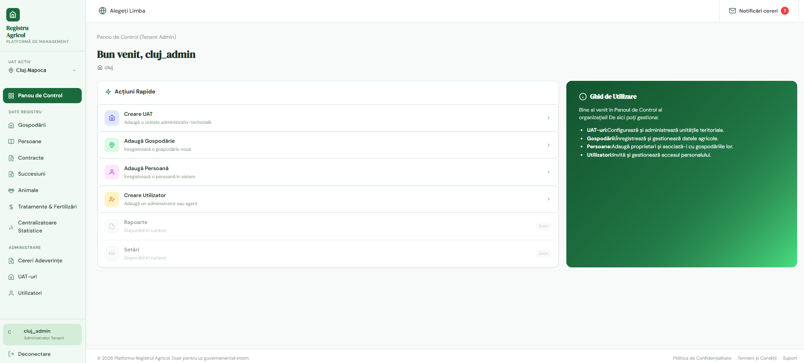

| Dashboard | Data and behavior |
| --- | --- |
| `/super-admin` | Loads `/api/tenants` and `/api/users?page=0&size=1000`; tenant count/schema cards, recent-tenant table, global user count, create shortcuts |
| `/tenant-admin` | Loads tenant-filtered users, supports view/role edit/delete, and shortcuts to UATs, households, persons, and user management |
| `/dashboard` | Older general dashboard with role-dependent tenant data and tenant-registration form |

Some dashboard content is demonstration UI: tenant UAT counts default to one when unavailable; “last login” is a placeholder; tenant-admin user loading falls back to a hardcoded sample team on error; super-admin export only logs a TODO. Super-admin user shortcuts navigate to `/users`, while the registered route is `/user-management`. The old general dashboard sends `sirutaCode` to a backend expecting `tenantId`. These screens are not verified system-wide agricultural analytics. The implemented reporting module is `/statistici`.

## Persons and identity documents

Routes `/persoane`, `/persoane/new`, and `/persoane/edit/:id` use the person list/form, `PersoanaService`, and `/api/persons` (also aliased as `/api/persoane`).

| Record | Stored information |
| --- | --- |
| Common person | Embedded address, phone/email, register volume/position, notes, tenant metadata, household memberships, person relationships |
| Physical person | First/last name, CNP and search hash, birth date, identity documents, death metadata |
| Legal entity | Company name, CUI and search hash, registration number, legal representative |
| Identity document | Type, series/number, issuing authority, issue/expiry dates; child of a physical person |
| Relationship | Related person and kinship/relationship enum; represented by `person_relations` |

The list searches names/company details and exact hashed CNP/CUI and filters physical/legal types with backend pagination. The dynamic form adapts to person type, supports identity-document and related-person collections, and associates households. `Persoana` uses JPA single-table inheritance in `persons`, with discriminator values `PHYSICAL_PERSON` and `LEGAL_ENTITY`. Membership uses `persons_gospodarii`; a person may have multiple associations.

The service resolves referenced records, sets parent references and tenant metadata, replaces child collections using orphan removal, and refuses changes between concrete person types. Person and selected related records support logical deletion. CNP/CUI fields use AES conversion and deterministic hash lookup; checksum validation and system-wide person-identifier uniqueness should not be inferred from these mechanisms. Database and DTO validation vary by operation. Updating a person through `PersoanaService` does not itself map the death fields; the succession service is the explicit death-recording path.

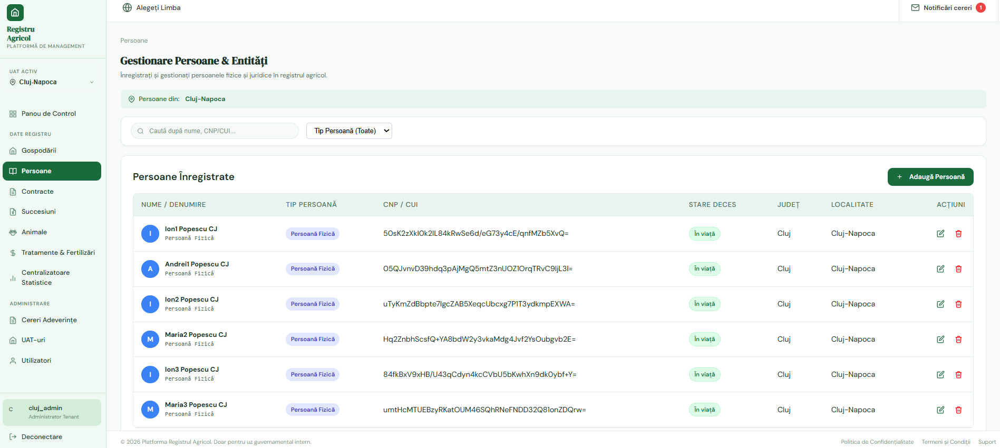

The person list displays “În viață”/“Decedat” from `esteDecedat`. Its supplied screenshot shows opaque identifier values in existing records; this does not establish a masking policy or correct conversion for every stored value.

Sources: [person model](../../src/backend/src/main/java/com/multitenant/model/persoana/Persoana.java), [person service](../../src/backend/src/main/java/com/multitenant/service/PersoanaService.java), [person form](../../src/frontend/src/app/pages/persoana-form/persoana-form.component.ts).

## Households and membership

Routes `/gospodarii`, `/gospodarii/new`, `/gospodarii/edit/:id`, and `/gospodarii/:id` implement **gospodării**, the central household/holding records. The screenshot named `pantries.png` shows this module; it does not represent food-storage inventory.

Households have a register code, structured address, type (`INDIVIDUALA`, `COLECTIVA`, `ASOCIATIE`), active flag, local UAT link, and optional `capGospodarie` person reference. The backend list supports UAT code, type, activity, search, and pageable retrieval. The UI has create/edit/detail/delete actions and corresponding confirmation/error states.

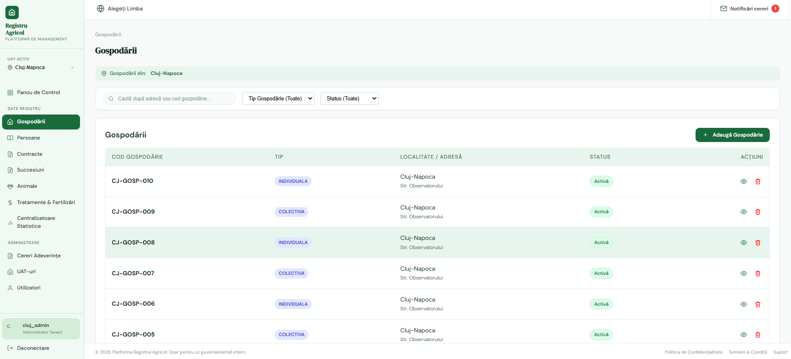

The household detail workspace brings together general information, members, member history, land, land-book details, buildings, machinery, animals, and documents. These are embedded sections/components, not independent frontend applications or necessarily standalone routes.

Operators can search existing persons and add membership through `POST /api/persons/{personId}/gospodarii/{householdId}`. A duplicate membership link is avoided. Head assignment/removal uses separate PUT endpoints. The server resolves the person and household but does not enforce every historical requirement (adult head, compulsory head on every active household, or mandatory membership of the selected head).

Member-history entries record a person, date, observations, and event type: birth/marriage/move entry; death/divorce/move exit; or other. They can link a household document, be listed newest-first, and be created/edited. Updating verifies the event belongs to the addressed household. Deleting a document detaches its history references. Membership history is a separately entered timeline; saving an exit event is not proof of automatic removal from the membership join table or automatic succession of the household head.

The current household service does **not** automatically create a land holding. That behavior and a strict 1:1 household/land relationship occur in older documentation; current land-to-household modeling is many-to-one.

Sources: [household detail component](../../src/frontend/src/app/pages/gospodarie-details/gospodarie-details.component.ts), [household service](../../src/backend/src/main/java/com/multitenant/service/GospodarieService.java).

## Land, parcels, and cadastral references

`/terenuri/new` creates land in a household; `/terenuri/:id/parcele` manages its parcels and related agricultural sections. The hierarchy is **UAT → household → land (`Teren`) → parcel (`Parcela`)**.

Land stores name, land type, household, optional Stereo70 text coordinates, and a JSONB polygon. A parcel stores name, positive area in hectares, agricultural-use category, cadastral number, intravilan/extravilan zone, use-right holder text, growing environment, optional useful area in square metres, JSONB polygon, and coordinate text. `CAMP_DESCHIS`, `SOLAR`, and `SERA_INCALZITA` distinguish open field, unheated protected space, and heated greenhouse.

The UI can create land with an initial parcel through `/api/terenuri/with-parcela`, edit/delete parcel records, manage land-use labels, and open a parcel map. Explicit category records under a land (`categorii_folosinta`) coexist with the parcel's `categorieFolosinta` string and public category lookup; they are not one normalized foreign-key relationship.

Land-book entries (`carti_funciare`) hold a land reference, book number, topographic number, registered total area, and timestamps. Creation is handled by domain events on land/parcel operations; the UI loads by land and updates an existing entry. `CarteFunciaraEventListener` is the source for automatic entry/surface behavior. Ownership quotas, encumbrances, official ANCPI queries, parcel split/merge, and spatial overlap enforcement described historically are not implemented by this model.

Sources: [land service](../../src/backend/src/main/java/com/multitenant/service/TerenService.java), [parcel service](../../src/backend/src/main/java/com/multitenant/service/ParcelaService.java), [land-book listener](../../src/backend/src/main/java/com/multitenant/event/CarteFunciaraEventListener.java), [parcel workspace](../../src/frontend/src/app/pages/teren-parcele/teren-parcele.component.ts).

## Agricultural submodules

The parcel workspace contains dedicated forms/tables backed by Angular services and tenant APIs. They extend far beyond the existing screenshot selection.

| Module | Fields, actions, and business meaning |
| --- | --- |
| Annual crops (`culturi_parcele`) | Agricultural year, crop species, cultivated hectares, sowing/harvest dates, kg/ha, total tonnes, irrigation, soil, preceding crop; list/create/edit/delete by parcel |
| Fruit trees (`pomi`) | Isolated-tree or plantation mode, species/variety, planting year, count or hectares/density, condition, maintenance, irrigation, estimated kg, observations; public species lookup |
| Vineyards (`vita_de_vie`) | Isolated/plantation mode, species/variety, year, vine count or hectares/density, condition, maintenance, irrigation, estimated yield |
| Pastures/hayfields (`pasuni_fanete`) | Grazing/mowing/mixed use, hectares, dominant species, grazing headcount or mowing frequency, estimated kg/ha, vegetation condition and management |
| Forestry (`paduri`) | Forest/woody vegetation type, dominant species, hectares, planting year, condition, observations |
| Water sources (`surse_apa`) | Source type, flow in m³/hour, working-state flag; service rejects negative flow and verifies parcel ownership on edit/delete |
| Land-use categories | Name/description under land; public lookup values aid selection elsewhere |

Nested services check parent ownership on many update/delete operations, and DTOs contain varying Bean Validation rules. UI category/mode controls and conditional fields must not be generalized into backend-enforced area balance or uniqueness guarantees. For example, crop-surface constraints described in historical specifications are not a blanket service validation in `CulturaParcelaService`.

### Production cycles, harvests, and protected spaces

Production cycles (`cicluri_productie`) are distinct from annual crop declarations. They record crop, establishment date, removal/end date (`dataDefisare` is the source field spelling), status (`ACTIV`/`FINALIZAT`), and support-program flag. The service rejects a second active cycle on the same parcel and fills an end date when finalizing without one.

For protected spaces, treatment, fertilization, and harvest services require a cycle active on the operation date. A protected-space harvest takes its crop name from that cycle. Open-field operations may link a cycle when available. The cycle service emits a soft warning for certain protected-space/support-program or tomato entries below 1,000 m². This is an implemented threshold message, not independently verified legal eligibility.

Harvest records (`recoltari`) contain date, crop, kilograms, parcel, and resolved cycle. The annual harvest centralizer groups normalized crop names by environment, totals kg, counts each contributing parcel's surface once, and calculates kg/m². A protected-space PDF register has a backend endpoint and an Angular cycle-service method; verify the current screen binding before treating every service method as an exposed button.

Environmental observations (`factori_mediu`) record temperature, relative humidity, and time. Their backend rejects open-field parcels. **No dedicated frontend environmental-observation service or entry workflow was found**; classify these operations as backend functionality.

Sources: [production cycles](../../src/backend/src/main/java/com/multitenant/service/CicluProductieService.java), [harvests](../../src/backend/src/main/java/com/multitenant/service/RecoltareService.java), [environment](../../src/backend/src/main/java/com/multitenant/service/FactoriMediuService.java).

## Buildings, machinery, and household documents

Buildings are household records with destination/use, built area, completion year, materials, address/parcel description, and optional land relationship. Embedded management supports list/create/edit/delete. Machinery records contain type, make, model, manufacture year, registration number, and household; their management component and API support CRUD. These records feed selected certificate/reporting output; there is no corresponding implemented tax-assessment engine.

The household document section uploads multipart `file` + JSON metadata to `/api/documente`, lists records by household, downloads blobs, and deletes records/files. Metadata includes document type, issue/optional expiry date, observations, activity, upload user/time, MIME type, size, and stored path.

`DocumentService` allows PDF, JPEG, PNG, legacy Word, and DOCX; its limit is 10 MiB and it checks the declared MIME type. A randomized/sanitized filename is stored below `<storage-path>/<householdId>/`. Download/delete also check the supplied household ID. Spring multipart defaults may impose a smaller limit because the application does not set a matching 10 MiB multipart configuration. Household document upload is not integrated into citizen application submission.

The file directory omits tenant ID, although database metadata is schema-scoped. Signed-contract files have another storage concern described under [multi-tenancy](../Multi-Tenancy.md#isolation-limits).

Sources: [document controller](../../src/backend/src/main/java/com/multitenant/controller/DocumentController.java), [document service](../../src/backend/src/main/java/com/multitenant/service/DocumentService.java).

## Animals and group headcounts

`/animale` provides individual/group tabs, search/filter controls, and links to create/edit/timeline workflows. Individual records have a household, person owner, ear tag (*crotal*), species, breed, sex, birth date, weight, active state, and tenant metadata. Species are `BOVINE`, `PORCINE`, `OVINE`, `CAPRINE`, `PASARI`, `ECVINE`, `APICOLE`, and `ALTELE`.

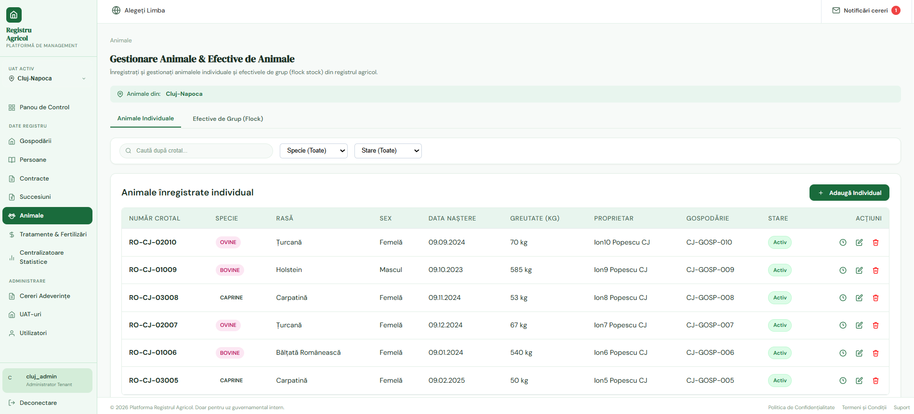

The individual service requires household and owner IDs, resolves both records, checks active local ear-tag conflicts, and coordinates the global `public.crotalii_registry`. The global registry supports application-wide ear-tag ownership checks; it is not an integration with a national veterinary system.

Groups contain household, owner, species, count/families, date, and details. Positive counts are required. Updating a group headcount uses a new dated **snapshot**, preserving earlier observations rather than overwriting them. The API exposes full history and latest snapshots per household/species. Equal-date latest snapshots can both match the repository's maximum-date query; no unique daily-snapshot rule is established.

The individual timeline supports origin events (`NASTERE`, `CUMPARARE`, `TRANSFER_INTRARE`), repeatable `TRATAMENT_VETERINAR`, and terminal events (`VANZARE`, `SACRIFICARE_PROPRIE`, `MOARTE`, `UCIDERE_FOCAR`, `DISPARITIE`). Service validation requires event type/date, prevents a second origin event, rejects additions to inactive animals, and prevents event dates before the latest event. Terminal events mark the animal inactive.

### Animal treatment history

Veterinary treatment is an animal timeline event, with event date and descriptive details. There is no separate normalized veterinary medication/type catalog, dosage course, or treatment scheduler. Do not confuse it with `/evidenta-chimica`, which treats crops.

### Cross-tenant transfers

The timeline can select destination tenant/UAT, household, and person through destination lookup APIs and call `/api/animals/individual/{id}/transfer`. The backend validates the destination before source changes, records source sale/inactivity, copies the animal and its event history into the destination schema, records entry, and updates global ear-tag ownership. It uses explicit transactions and an attempted source compensation if destination insertion fails. This is not a single atomic distributed transaction. [Transfer workflow](../Workflows.md#animal-transfer-between-tenants).

Sources: [animal service](../../src/backend/src/main/java/com/multitenant/service/AnimalIndividualService.java), [event rules](../../src/backend/src/main/java/com/multitenant/service/EvenimentAnimalService.java), [group service](../../src/backend/src/main/java/com/multitenant/service/EfectivGrupService.java), [transfer service](../../src/backend/src/main/java/com/multitenant/service/CrossTenantTransferService.java).

## Plant treatments and fertilization

`/evidenta-chimica` has plant treatments, fertilization, catalogs, and parcel history tabs. The screenshot `treatments.png` is **plant-protection administration**, not animal treatment management.

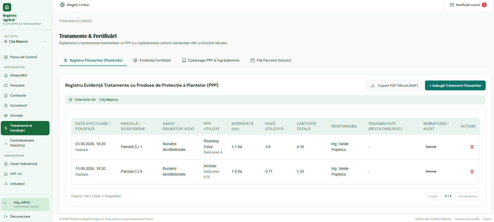

Plant treatment captures date/time, crop phase, parcel, pest, selected PPP (*produs de protecție a plantelor*), dose/unit, treated hectares, calculated total quantity, responsible operator, signature text, planned harvest date, consumption document, and any overdose justification. Biological control/pollinator entries additionally use release date and box/individual counts.

`TratamentFitosanitarService` resolves the parcel/product and active cycle. It converts dose units for comparison, requires justification above the catalog's approved dose, and rejects a harvest start before treatment date plus the product's pause period. Biological entries bypass the chemical overdose/pause branch. Total quantity is stored as **submitted dose × treated area**; the unit conversion for validation does not make that total universally litres. A signature string in this module is not equivalent to SignNow verification.

Fertilization captures date, parcel, fertilizer, gross quantity/unit, and calculated N/P/K. Tonnes-per-hectare inputs are multiplied by 1,000 before applying catalog percentages. The service asks for an explicit override in its 15 November–15 March winter interval and rejects an organic-input calculation above its 170 kg N/ha/year threshold. The organic-input branch sums all recorded nitrogen for that parcel/year, without filtering earlier records by organic fertilizer type, and subtracts the edited record's prior nitrogen on update. These source rules are not a certification of legal compliance.

Both product catalogs provide search/list/CRUD. ADMIN/SUPER_ADMIN may mutate catalogs; USER may read them. A parcel's *fila parcelei* combines treatment and fertilizer activity for selected periods. A backend PDF export builds the plant-protection register using Thymeleaf/OpenHTMLtoPDF.

Sources: [chemical workspace](../../src/frontend/src/app/pages/evidenta-chimica/evidenta-chimica.component.ts), [treatment rules](../../src/backend/src/main/java/com/multitenant/service/TratamentFitosanitarService.java), [fertilization rules](../../src/backend/src/main/java/com/multitenant/service/FertilizareService.java), [parcel activity](../../src/backend/src/main/java/com/multitenant/service/FilaParceleiService.java).

## Contracts and electronic signing

`/contracte` manages parcel-utilization contracts, with detail/create/edit/delete, text/type/status filters, UAT context, and signing actions. Types are `ARENDA` (agricultural lease), `COMODAT` (loan for use), `CONCESIUNE`, `INCHIRIERE`, and `ALTELE`. Status values are `ACTIV`, `EXPIRAT`, `REZILIAT`, and `SUSPENDAT`.

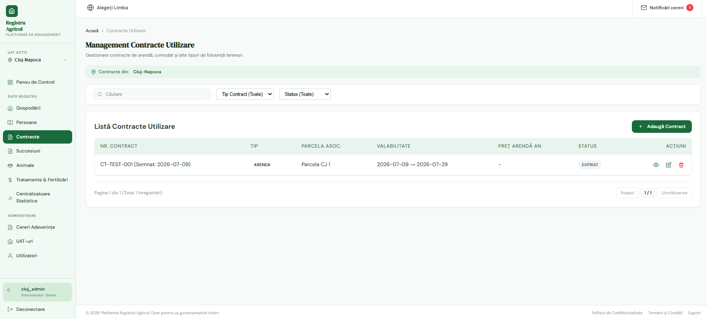

The form records contract number/type, required parcel, optional owner/landlord and user/tenant person links, signing/start/end dates, annual rent in RON or wheat kg/ha, price-indexation flag, status, active flag, and termination reason. The service resolves references and records the operating user; price indexation is a stored flag, not an implemented automatic rent recalculation. Date ordering and overlapping active contracts are not comprehensively enforced by the current service.

The scheduler runs **every minute**, despite its midnight-oriented method name and historical guide. Per tenant it expires active-status contracts whose end date is before today and emits alerts for active contracts ending before today + 30 days. The selection can repeat alerts each minute; there is no persisted deduplication/inbox.

Signing generates an OpenPDF contract, uploads it to SignNow, and sends a free-form invitation to the entered email. Operators explicitly poll status with a POST action. Once signed, the backend downloads the PDF, calculates SHA-256, saves a local file, and stores signature/status/path metadata. A GET action downloads the saved signed document. Credentials/network access are required; this documentation did not send invitations or validate a live SignNow transaction. No callback/webhook flow was found.

Sources: [contract service](../../src/backend/src/main/java/com/multitenant/service/ContractUtilizareService.java), [scheduler](../../src/backend/src/main/java/com/multitenant/service/ContractExpirationScheduler.java), [signature service](../../src/backend/src/main/java/com/multitenant/service/ContractSemnaturaService.java), [SignNow client](../../src/backend/src/main/java/com/multitenant/service/signnow/SignNowClient.java).

## Succession notices and death records

`/succesiuni` implements **mențiuni succesiuni și urmărirea notificărilor către notari (SPN/BIN)**. It records correspondence and progress, rather than deciding legal inheritance or transferring ownership shares.

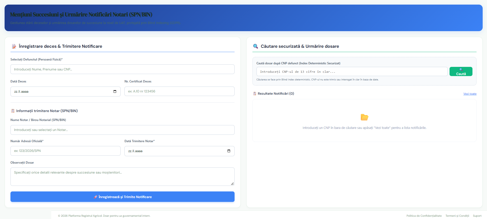

1. Search physical persons by name/identifier; select an existing deceased person record.
2. Enter optional death date/certificate number and notary name, required official correspondence number and sent date, and observations.
3. Submit with initial `TRIMIS` state. The backend validates a physical-person reference, marks it deceased, records the supplied death metadata, and saves the notice with the authenticated operator.
4. The entity copies the person's blind index into `defunct_cnp_hash` and sets registration time if absent. The current table is tenant-schema scoped and has **no `tenant_id` column**.
5. A Kafka event is attempted; the consumer broadcasts to `/topic/notificari/general`.
6. List all notices or search by the full 13-character identifier; update the stage with PATCH. UI choices are `TRIMIS`, `IN_LUCRU`, and `FINALIZAT`; the service accepts other nonblank strings.

Notary suggestions are hardcoded sample names, not a synchronized notary registry. “Trimite Notificare” saves correspondence metadata and publishes an internal event; no notarial email, delivery receipt, external notary API, generated notarial document, heir records, estate allocation, ownership-quota update, or automated head replacement was found. The current succession component does not subscribe to the general WebSocket topic, so its list is refreshed after its own operations rather than through that broadcast.

The original Romanian [succession use cases](../Derived/succesiuni_notificari_documentatie.md) remain in full, with a correction notice. Their references to V39, separate `persoane_fizice`, a tenant column, digital operator signature, and guaranteed private/log-free messaging are historical inaccuracies; current death/notice migration is V53 against the single `persons` hierarchy.

## Citizen applications and certificates

`/cereri-admin` and the layout's application panel receive applications from the independent Citizens Portal. The page separates pending/resolved records, opens application details, and submits ACCEPTED/DECLINED status decisions. The backend is `/api/admin/cereri`; the selected tenant comes from the institutional JWT, not a citizen-provided UAT parameter.

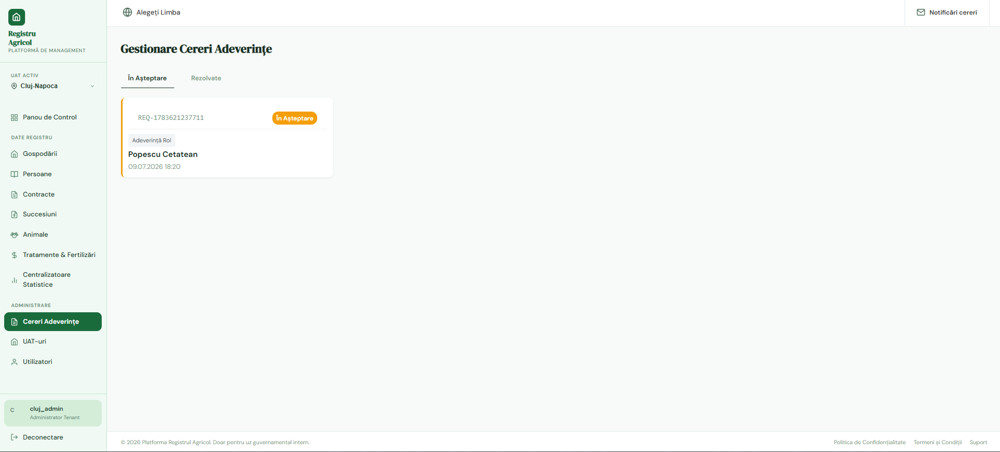

The filename `affidavit-request.png` represents *cereri adeverințe* (applications for certificates). “Affidavit” should not imply sworn-statement processing absent from the source.

The implemented statuses are `PENDING`, `ACCEPTED`, and `DECLINED`. The service assigns the supplied enum and does not enforce a strict one-way lifecycle. On first transition into acceptance it can resolve/create a physical-person record from application identity, issue producer attestation metadata (60-month validity) or a booklet linked to an existing attestation, and update global account flags. A booklet application may be marked accepted without creating a booklet when no attestation exists. Re-acceptance after another status can repeat issuance because there is no durable issuance idempotency key.

Decisions publish application-code, tenant, and citizen-user topics. Accepted PDF generation selects dedicated producer/booklet/role templates or a generic application template. It uses current database data and does not automatically digitally sign citizen certificates. There is no clerk-assignment queue, legal deadline tracker, response message/rejection reason field, application attachment workflow, or complete administrative audit state machine.

Sources: [admin application component](../../src/frontend/src/app/pages/cereri-admin/cereri-admin.component.ts), [application service](../../src/backend/src/main/java/com/multitenant/service/CerereService.java), [PDF controller](../../src/backend/src/main/java/com/multitenant/controller/CererePdfController.java).

## GIS and maps

`/harta` uses `ParcelaMapComponent`; `/google-harta` actually uses `OsmMapComponent` with Leaflet and OpenStreetMap. The route name does not establish a Google Maps integration.

The parcel map renders GeoJSON Polygon/MultiPolygon boundaries, fits map bounds, shows tooltips with parcel/household context, colors selection, and changes behavior with land context. It queries locality boundaries through Nominatim; OSM provides base tiles. Coordinate forms accept Stereo70 points, convert them to WGS84, close GeoJSON rings, and calculate hectares from planar coordinates.

`CoordConversionService` contains the inverse projection and three-parameter datum-shift arithmetic in TypeScript. Area uses a shoelace calculation and scale-factor adjustment. Its source comments describe approximate transformation accuracy; no independent survey-grade verification is established. GeoJSON coordinates use `[longitude, latitude]`, while Leaflet positions use `[latitude, longitude]`.

Current polygons are Jackson `JsonNode` mapped to PostgreSQL JSONB; V16.1 converts earlier geometry storage. The Compose image includes PostGIS and the POM declares spatial/JTS/Proj4J dependencies, but active polygon persistence and conversion do not establish spatial overlap SQL or backend Proj4J processing. No active Leaflet Draw plugin or official cadastral boundary integration was found.

Sources: [parcel map](../../src/frontend/src/app/components/parcela-map/parcela-map.component.ts), [OSM map](../../src/frontend/src/app/components/osm-map/osm-map.component.ts), [coordinate conversion](../../src/frontend/src/app/services/coord-conversion.service.ts), [parcel model](../../src/backend/src/main/java/com/multitenant/model/registru/Parcela.java).

## Statistics and reporting

`/statistici` presents summary cards and vegetal, livestock, and machinery tables. Year choices are hardcoded 2024–2028 with initial 2026. Active UAT is passed to the main statistical API. Three Excel exports are real `.xlsx` files generated by Apache POI, not the CSV described by an older report.

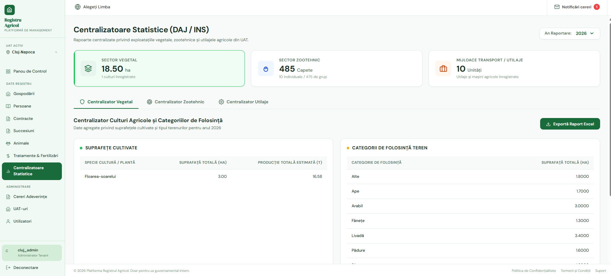

| Dataset | Calculation and filter semantics |
| --- | --- |
| Annual crops | Group by species; SUM cultivated hectares and stored production tonnes for selected agricultural year and optional UAT |
| Land use | Group parcel `categorieFolosinta`; SUM parcel hectares for optional UAT; not a historical year snapshot |
| Individual livestock | Count active animals by species and sex for optional UAT |
| Group livestock | Sum headcounts at each household/species maximum snapshot date; equal-date rows can both contribute |
| Machinery | Count units by machinery type for optional UAT |
| Harvest centralizer | Group year-filtered harvests by normalized crop/environment; sum kg, unique contributing parcel surface, kg/m²; endpoint currently has no UAT-code filter |

The vegetal summary card adds crop hectares **and** land-category hectares, which can describe the same land twice. It must not be labeled as a deduplicated territorial area. Changing year affects annual crops and harvests, not all inventory aggregates. The implemented visualizations are cards and tables; no charting library/dashboard should be inferred.

Sources: [statistics component](../../src/frontend/src/app/pages/statistici/statistici.component.ts), [report service](../../src/backend/src/main/java/com/multitenant/service/RaportStatisticService.java), [harvest centralizer](../../src/backend/src/main/java/com/multitenant/service/RecoltareService.java), [repositories](../../src/backend/src/main/java/com/multitenant/repository).

## Institutional administration and super-administration

### Tenant organization management

`/tenants` lists/searches tenants, creates a tenant ID/name, displays its schema, and renames it. The backend creates `uat_<tenantId>` and runs tenant Flyway migrations before saving the global registry row. `/api/tenants/migrate-all` is a backend super-admin operation without a dedicated primary navigation action.

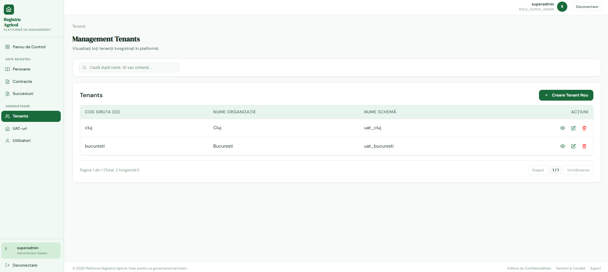

Tenant details offer UAT assignment/removal UI, but call `/api/tenants/{id}/uats/{code}`, for which no controller exists. These actions are **frontend functionality without matching backend integration**. The tenant-delete button displays a manual-intervention alert; there is no delete endpoint. `Tenant.isActive` exists, but the exposed update only renames the tenant; no complete tenant activation/deactivation workflow or enforcement was found.

### Global and tenant UATs

Super-admins manage the global directory (`public.uats`) with name, SIRUTA code, county, type, activity, and tenant association. Tenant admins assign an unclaimed global UAT through `/api/uats/tenant/{codSiruta}`; the service copies UAT data into the tenant schema and updates the global tenant assignment. Claiming an already assigned unit is rejected. Removal deletes the local UAT and clears its association according to the service implementation.

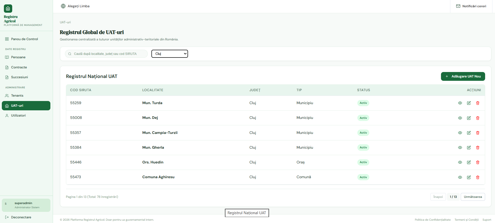

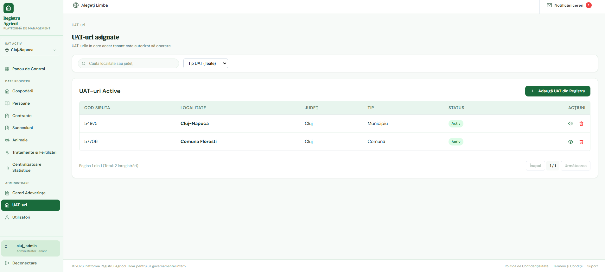

The global directory is shared reference data, not proof of an active institution deployment for every locality. `/uats/:id` is an additional detail route. Tenant access and UAT filters have different enforcement responsibilities; a UAT ID claim is not a universal row-level restriction.

### User administration

`/user-management` lists users with search, role/status filters, create/edit/delete, and tenant/UAT selection depending on the current account. The server returns `UserDTO` without passwords. Global users live in `public.users` with a tenant ID; tenant admins are forced to their own tenant on create and receive tenant-filtered listings. `UserSecurity` checks target-user tenant on individual operations; ordinary users can update their own account only under the method expression's constraints, including no supplied role.

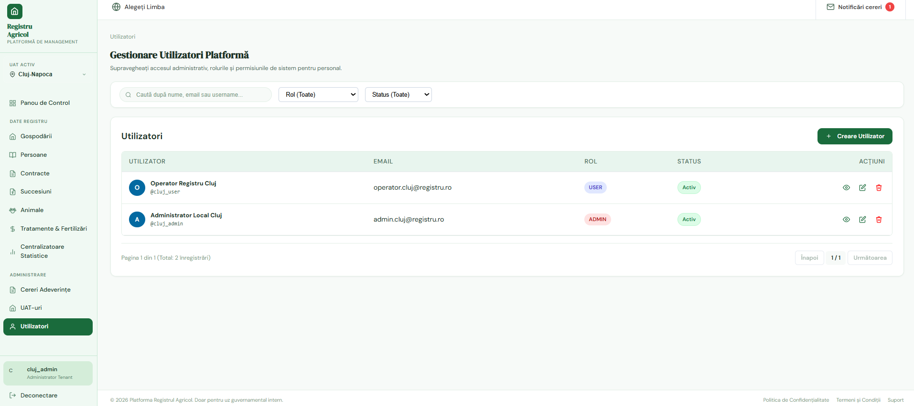

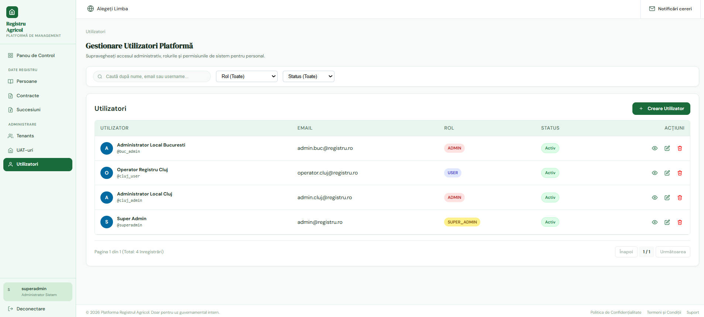

Role creation/update restrictions reject a tenant admin assigning SUPER_ADMIN, but there is no full database-backed permission catalog. User activity is checked at institutional login. Existing JWTs reconstruct `active=true` from token claims and do not reload user/tenant active status each request, so disabling an account is not immediate token revocation.

### Super-administrator workspace

The dashboard provides tenant/user overview and shortcuts; the underlying role can access global tenant/UAT/user operations and request a tenant-context JWT through `/api/auth/impersonate`. This changes the tenant claim while retaining role and user ID. It does not create an ordinary tenant user or open an additional application.

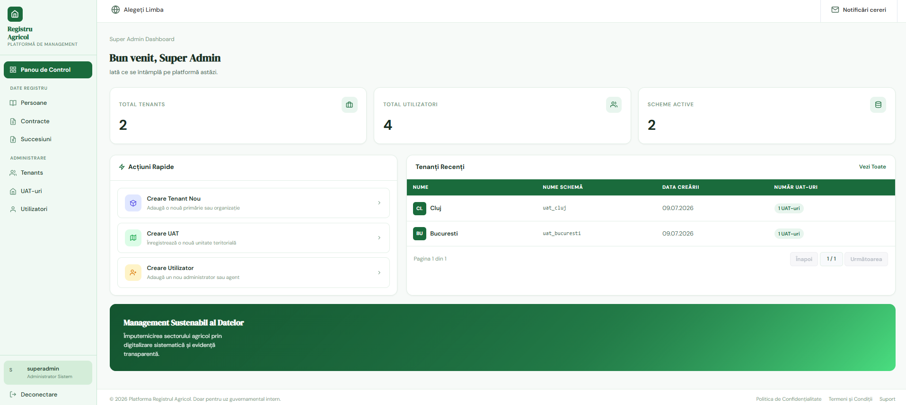

Impersonation does not validate tenant existence/activity in the controller, and stop-impersonation has a sidebar subscription issue documented in [implementation status](../Implementation-Status.md). System-wide operational agricultural statistics across all schemas are not implemented by the dashboard's counts.

## Remaining functionality and limits

Romanian/English Angular localization uses XLF files, `$localize`, a translation pipe, localized production output, and Nginx language routing. Generic form/table components centralize field rendering, filtering, pagination, and modal CRUD patterns. Street autocomplete calls Nominatim; lookup endpoints supply soil, categories, water-source types, document types, and tree species, with selected Spring cache annotations.

Envers and annotated access logging are backend traceability mechanisms, with parcel-history retrieval and membership timelines exposed in the application. There is no dedicated general GDPR-audit viewer route. See [domain/DTO reference](../Reference/Domain.md), [API catalog](../Reference/API.md), [route/service inventory](../Reference/Source-Inventory.md), and [implementation-status register](../Implementation-Status.md) for complete coverage and source anchors.
