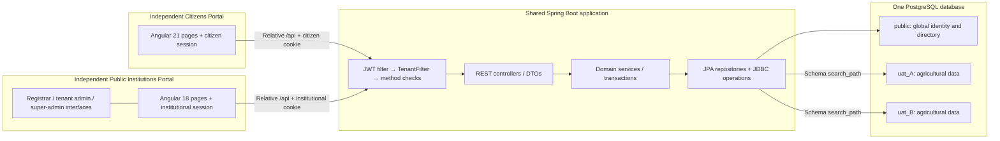

# System architecture

[Documentation index](README.md) · [Multi-tenancy](Multi-Tenancy.md) · [Backend](Backend.md)

Registru-Agricol consists of two independently built single-page applications and a shared Spring Boot backend. A PostgreSQL database, Kafka/ZooKeeper, filesystem storage, and external SMTP, mapping, and signing services support that backend. The code does not implement separately deployed domain microservices.

## Deployment and application boundaries

| Unit | Implementation | Responsibility |
| --- | --- | --- |
| Citizens Portal | `src/portal-cetateni`, Angular 21, independent Node build and Nginx runtime | Citizen accounts, service catalog, applications, tracking, profile, live alerts |
| Public Institutions Portal | `src/frontend`, Angular 18, independent localized build and Nginx runtime | Operational register, tenant/user/UAT administration, institutional application decisions |
| Shared backend | `src/backend`, one Maven project and executable Spring Boot JAR | Security, REST, domain rules, persistence, documents, jobs, messages |
| PostgreSQL | Compose `postgis/postgis:15-3.3`, one datasource | Shared `public` schema and independent tenant schemas |
| Kafka | Compose broker plus ZooKeeper | Contract-expiry and succession event transport |

The two frontends do not call each other. Their interaction is mediated by backend state and messages: citizens submit tenant-directed applications, institutions decide them, and the backend publishes status updates consumed by each application.



The database boundary is schema-per-tenant, with additional tenant ID columns on selected entities and global tenant-associated records. It is not database-per-tenant. A UAT selector in the institutional UI is a within-tenant filter; switching tenant requires backend context selection or a super-admin impersonation cookie.

## HTTP request paths

An institutional HTTP request carries the `jwt` cookie. `JwtAuthenticationFilter` validates the signature/expiry and reconstructs `UserDetailsImpl`, including authority, tenant, and UAT claims. `TenantFilter` sets the thread-local tenant and clears it in `finally`. Method authorization and `@TenantRequired` apply before domain operations. Hibernate resolves the tenant when acquiring a connection.

An HTTP request from the Citizens Portal normally begins in the `public` context because the citizen JWT has no tenant claim. A public application controller reads the global UAT record, explicitly selects its tenant, invokes tenant repositories/services, and clears context. Profile/account operations remain explicitly mapped to `public.cetateni`. Personal history and attestation status aggregate across distinct UAT-associated tenants.

This distinction matters for transaction lifetime: changing a thread-local value does not relocate an already-open Hibernate session. `open-in-view=false` and explicit transaction boundaries support context changes, while cross-tenant transfer uses separate `TransactionTemplate` operations.

## Frontend composition

Both applications use standalone Angular components, services, relative HTTP URLs, and cookie credentials interceptors. Citizens use template-driven forms, a citizen guard on two application routes, and an independently configured HttpClient Fetch backend. Institutions use generic dynamic/reactive forms, generic tables, embedded household/parcel managers, and Romanian/English localization.

The institutional route table contains no guards. Role-aware navigation and component redirects are user-interface behavior; server method checks define effective authorization. Citizen `/contul-meu` is also unguarded in the route table but profile endpoints check citizen identity. [Application-specific guides](Applications/Citizens-Portal.md) describe these differences rather than presenting one frontend with multiple roles.

## Domain and persistence

The primary record chain is local UAT → household → land → parcel. Persons can belong to several households; households optionally point to a head person. Buildings, machinery, animals, and documents link into that household/person graph. Annual crops, perennial crops, water, forestry, production cycles, treatments, fertilization, and harvests attach to parcels.

Global accounts are distinct from agricultural persons. A citizen account does not automatically create a `Persoana`; application acceptance may create a physical person if a matching CNP record is absent. This is implemented administrative behavior, not proof of full identity reconciliation.

Selected entities use Envers snapshots and soft deletion. Access logging is an AOP mechanism on annotated operations. Land creation publishes an in-process event; an AFTER_COMMIT listener with REQUIRES_NEW creates a land-book record. Parcel addition triggers a stored-area recalculation. These in-process events are separate from Kafka messaging.

## Events, email, and live updates

```mermaid
sequenceDiagram
    participant C as Citizens Portal
    participant B as Shared backend
    participant D as Tenant schema
    participant I as Institutions Portal
    participant M as SMTP
    C->>B: POST /api/public/cereri (UAT + form)
    B->>D: Save PENDING application + tracking code
    B-->>I: Tenant application topic
    B->>M: Attempt synchronous confirmation email
    B-->>C: Application DTO + tracking code
    I->>B: PUT /api/admin/cereri/id/status
    B->>D: Save decision; optional attestation/booklet side effects
    B-->>C: User and tracking-code topics
    B-->>I: Tenant application topic
    C->>B: GET accepted application PDF
    B->>D: Load data, check owner/status
    B-->>C: Generated application/pdf
```

Application updates are sent directly through `SimpMessagingTemplate`; they do not pass through Kafka. The backend uses an in-memory Spring simple broker under `/topic` with SockJS handshake `/api/ws`. This broker is separate from the Kafka broker.

| Event | Producer | Transport | Consumer / destination |
| --- | --- | --- | --- |
| Application create/decision | `CerereService` | Direct Spring messaging | `/topic/tenant/{id}/cereri`, plus decision topics for application code and user ID |
| Approaching contract expiry | `ContractExpirationScheduler` / contract service | Kafka `contracte-expirare` | `NotificationKafkaConsumer` → `/topic/notificari/{cnp}` → citizen profile |
| Succession notice | Succession service/producer | Kafka `notificari-succesiuni` | Consumer → `/topic/notificari/general`; current frontends do not subscribe to this general topic |
| Application email | `CerereService` → `EmailService` | JavaMail/SMTP with Thymeleaf | Supplied applicant email |

Only `contracte-expirare` has an explicit `NewTopic` bean; succession topic availability depends on broker configuration/provisioning. There is no outbox, persisted per-user delivery history, replay contract for the UI, or destination authorization configuration. Database saves and outbound messages/email are not one atomic delivery transaction.

## Documents and external integrations

| Integration | Actual usage and boundary |
| --- | --- |
| SMTP / Mailtrap | Application-confirmation email; runtime credentials required; caught failures; synchronous send |
| SignNow | RestTemplate client obtains token, uploads contract PDF, sends free-form email invite, polls status, downloads signed PDF |
| OpenStreetMap | Leaflet base tiles in institutional maps |
| Nominatim | Address/locality/boundary search through both direct frontend queries and backend proxy paths |
| Filesystem | Uploaded household files and downloaded signed contracts; database stores metadata/paths |
| Thymeleaf + PDF engines | HTML templates rendered by OpenHTMLtoPDF for certificates/registers; OpenPDF for contract layout |
| Apache POI | Excel reporting workbooks |

No active Google Maps, national identity provider, ANCPI, APIA/AFIR, ANSVSA/SNIIA, payment gateway, notarial delivery API, or external weather/sensor feed is established by the inspected code. Historical domain references to these institutions remain in [Historical](Historical/README.md).

## Operational limits

The checked-in configuration disables CSRF and CORS processing, issues non-Secure development cookies, permits public API and WebSocket handshakes, and logs SQL/debug data. Active-status changes are not checked on every JWT request. WebSocket topic names and document paths do not provide the same tenant boundary as database schemas. These are source observations, not a production security assessment or a completed remediation.

Compose uses `depends_on` without health checks, one database, one Kafka broker, and filesystem storage. No CI/CD pipeline, orchestrator deployment, managed secret rotation, backup/restore workflow, performance benchmark, horizontal broker scaling, or distributed tracing configuration was found. [Development](Development.md), [testing](Testing.md), and [implementation status](Implementation-Status.md) provide practical constraints.
