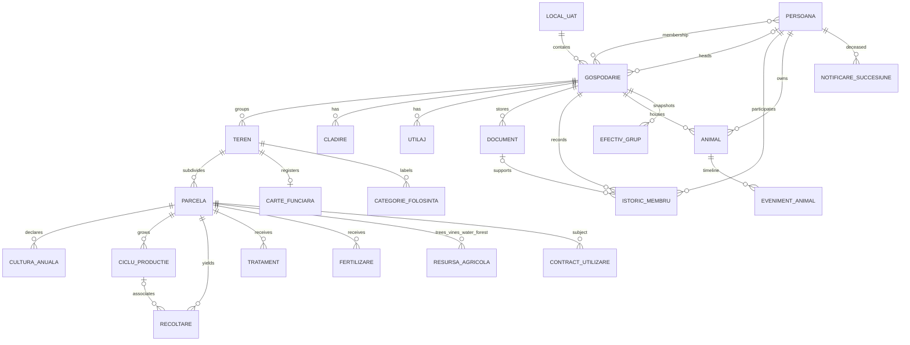

# Database and domain relationships

[Documentation index](README.md) · [Multi-tenancy](Multi-Tenancy.md) · [Entity/DTO dictionary](Reference/Domain.md) · [Migration catalog](Reference/Migrations.md)

The Compose database is PostgreSQL 15 using a PostGIS 3.3 image. One database contains global `public` tables and a schema per tenant (`uat_<id>`). JPA schema-relative entities use Hibernate search-path routing. Current polygons are JSONB, even though older migrations and declared spatial dependencies reflect earlier geometric designs.

## Global data

| Table / family | Purpose and relationships |
| --- | --- |
| `public.tenants` | Tenant ID/name/schema, timestamps and activity/deletion metadata |
| `public.users` | Institutional accounts, BCrypt password, role, tenant ID and optional UAT ID; listing scoped in user controller |
| `public.cetateni` | Independent citizen accounts, account type, profile/address, encrypted identifier/hash, password, attestation/booklet flags |
| `public.uats` | National/locality reference directory; numeric ID and SIRUTA code; optional claimed tenant association |
| `public.crotalii_registry` | Global active ear-tag location/reference for application-level conflict checking and transfers |
| Lookup tables | `tipuri_sol`, `categorii_folosinta_ref`, `tipuri_sursa_apa`, `tip_document`, `specii_pomi` |

Core entities explicitly map to the public schema; the older singular `uat`, `crotal_registry`, and lookup names are renamed by public V8. Global and local UAT IDs are not interchangeable: the citizen form addresses the **global numeric UAT ID**, whereas institutional filtering frequently sends a **SIRUTA code** and household foreign keys reference the tenant-local UAT.

## Operational relationship map

This diagram summarizes object relationships; `RESURSA_AGRICOLA` groups several separate tables for readability, and `PERSOANA` includes the physical-person subtype required for succession. It does not imply a physical aggregate-resource table. The field/mapping dictionary and SQL migrations provide exact nullability and constraints.

## Persons, households, and identity

`persons` uses `SINGLE_TABLE` inheritance for physical persons and legal entities. `person_type` discriminates the rows; subtype-specific columns are nullable where the other subtype uses the same table. `identity_documents` belongs to physical persons, while `person_relations` links persons using a relationship enum.

`persons_gospodarii` represents many-to-many membership. `gospodarii.cap_gospodarie_id` separately references a person; it replaces a historical boolean head flag on persons. A person may belong to more than one household and can be referenced as head independently of the membership join. Mandatory adult-head/member constraints in historical requirements are not universal current service rules.

`istoric_membri_gospodarie` records dated entry/exit/other events with a person, household, observations, and optional document. It is not itself the membership join table. V52 adds the supporting document foreign key with null-on-delete semantics. The document service additionally clears event references before logical document deletion.

`Adresa` is embedded into person/household tables with county/locality/street/number/building/staircase/floor/apartment/postal fields. Citizen profile addresses are a distinct account model with separately named fields; they are not automatically synchronized with institutional `Persoana.adresa`.

## Land, cadastre, and resources

A household has multiple land holdings, and each land has multiple parcels. Earlier 1:1 household/land documentation is preserved as history. Land and parcel coordinates/GeoJSON can both exist. Parcel area is hectares; useful protected-space area is square metres. Polygon JSONB is not a database-enforced valid cadastral geometry.

`carti_funciare` has a unique land relationship in the migration/model design, land-book/topographic identifiers, stored registered area, and timestamps. Domain listeners create a blank entry after land creation and sum parcel area after addition. It is a local administrative record, not synchronized official land ownership. Recalculation after an add event does not establish automatic consistency for every parcel edit/deletion.

`categorii_folosinta` stores labels/descriptions per land. Parcel `categorie_folosinta` remains a string, and `public.categorii_folosinta_ref` is a separate lookup list. Do not treat all three as one foreign-key-normalized land-use allocation model.

Parcel child tables cover annual crops (`culturi_parcele`), fruit trees (`pomi`), vines (`vita_de_vie`), pastures/hayfields (`pasuni_fanete`), forestry (`paduri`), and water sources (`surse_apa`). Isolated/plantation modes and counts/densities are represented by fields/enums, not separate inheritance tables.

## Production, chemicals, and harvests

`cicluri_productie` stores parcel, crop, start/end, status, and support-program flag. `recoltari` stores parcel/cycle/date/crop/kg. `factori_mediu` stores parcel observations such as temperature/humidity/time. Treatment/fertilization operations resolve an active cycle by date where protected-space rules require one.

`catalog_ppp` and `catalog_ingrasaminte` are tenant-local product catalogs. `tratamente_fitosanitare` references parcel/product/cycle and captures dose, area, calculated quantity, responsibility, pause/harvest and biological release information. `fertilizari` references parcel/product/cycle and stores calculated N/P/K. These modules have their own audit-table migrations and selected entity annotations; a migration-created `_aud` table alone does not prove every write is currently audited.

## Animals and contracts

`animale_individuale` references household and person owner; `evenimente_animale` references the animal and stores event/date/details and optional destination tenant. `efective_grup` stores dated headcount snapshots with household/person/species. Global tag registry state supplements tenant records for active ear-tag conflicts; animal transfer creates a new destination-local ID while retaining ear-tag identity and copied history.

`contracte_utilizare` references a **parcel**, replacing the former land relation through V27. Optional person links identify owner/landlord and user/tenant. Dates, rent fields, state/activity, operator metadata, and signing fields are stored on the contract. V22/V48 remove obsolete operating-user foreign keys; operator IDs refer conceptually to global users. Overlapping dates are not prevented by a verified active-contract exclusion constraint.

Signed PDFs have path/hash/status metadata; file bytes are not in the relational table. The fixed contract-ID filename is not tenant-partitioned and is a known storage collision concern.

## Applications, attestations, and succession

`cereri` is tenant-local, with applicant/contact/address, CNP/CUI ciphertext/hash, code, status, type, global citizen `user_id`, public `uat_id`, and creation time. Scalar user/UAT IDs should not be described as enforced cross-schema JPA ownership relationships. Citizen history loops through schemas to find `user_id` matches.

`atestate_producator` associates a person with number/series, issue date, validity, observations, and logical deletion. `carnete_comercializare` references a person and attestation. Global citizen flags cache existence for UI status checks; they do not themselves establish current validity or issue uniqueness.

`notificari_succesiuni` is created by **tenant V53**, with deceased-person FK to `persons`, identifier hash, notary/correspondence metadata, stage, observations, operator, and timestamp. V53 adds death fields to both `persons` and `persons_aud`. There is no `persoane_fizice` table, `tenant_id` notice column, inheritance-share table, heir association, or notary-delivery receipt in this implementation.

## Logical deletion, encryption, and audit

Many entities use `@SQLDelete` and `@SQLRestriction("deleted = false")`, with partial indexes introduced in soft-delete migrations. This is not universal across every entity/table. Normal JPA removal of a household does not imply a complete physical cascading deletion of all assets. Physical file deletion in the document service has different semantics from logical record deletion.

Selected identifiers use AES conversion and salted hash indexes. Public V12 and tenant V37/V38 contain identifier migration/backfill logic; current key/salt settings matter for existing encrypted/hash data. Current code has a fallback returning undecryptable data unchanged, which requires caution when interpreting sample screenshots or search behavior. [Protection implementation](Backend.md#identifier-protection-and-audit).

Envers uses tenant-local revision and audit tables, with a username revision listener. `gdpr_audit_logs` stores selected access-operation metadata within the tenant schema. Neither means all actions or tables are covered. The migration catalog preserves exact scripts and the reference dictionary records actual annotations.

## Migration organization and execution

| Migration set | Execution |
| --- | --- |
| `db/migration` | Spring Flyway on `public`; validate-on-migrate true, out-of-order false, clean disabled |
| `db/tenant` | TenantService on each schema; out-of-order true, validation disabled, repair then migrate |

The repository contains **71 SQL migrations** across the two sets, including fractional versions and historical repair/recreation scripts. Version numbers are not a count and are not contiguous. [Every migration with source link](Reference/Migrations.md).

Important evolution points include singular→plural names; household/land/parcel restructuring; many-to-many membership; national ear-tag registry; JSONB polygon conversion; documents; Envers/access logs; application/account identifiers; crop-resource modules; producer documents; protected production; logical deletion; signing; member history; and succession V53. Existing migration text is authoritative for the sequence; this documentation does not change or consolidate it.

The startup seeder migrates tenants, ensures accounts, and creates demo agricultural records across Cluj/București. It runs without a development-only profile restriction. Backups and migrations should be reviewed separately before connecting this implementation to a valuable existing database. This task did not execute migrations against a database.
