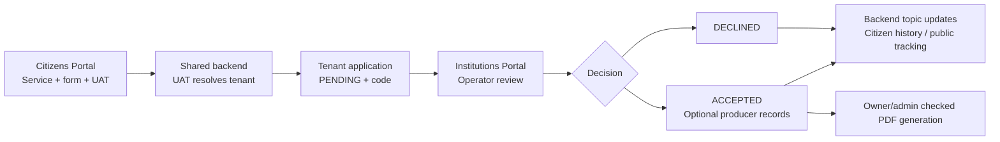
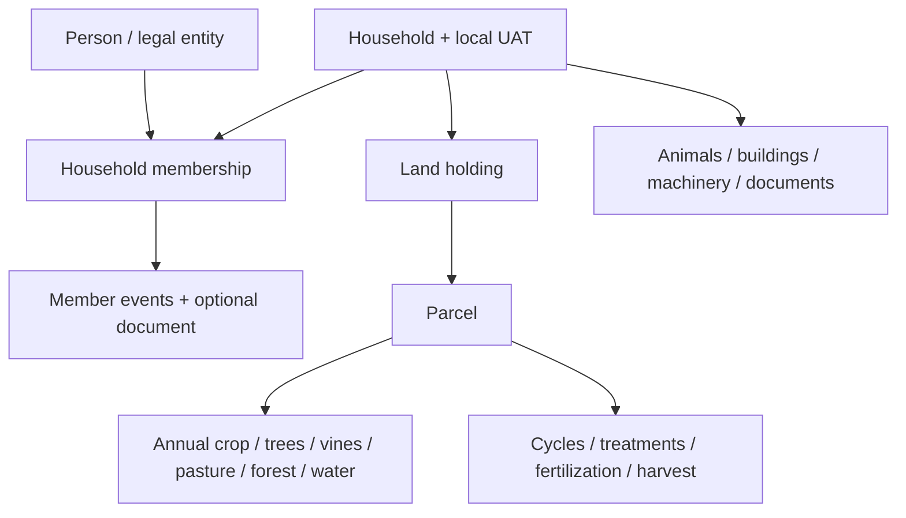
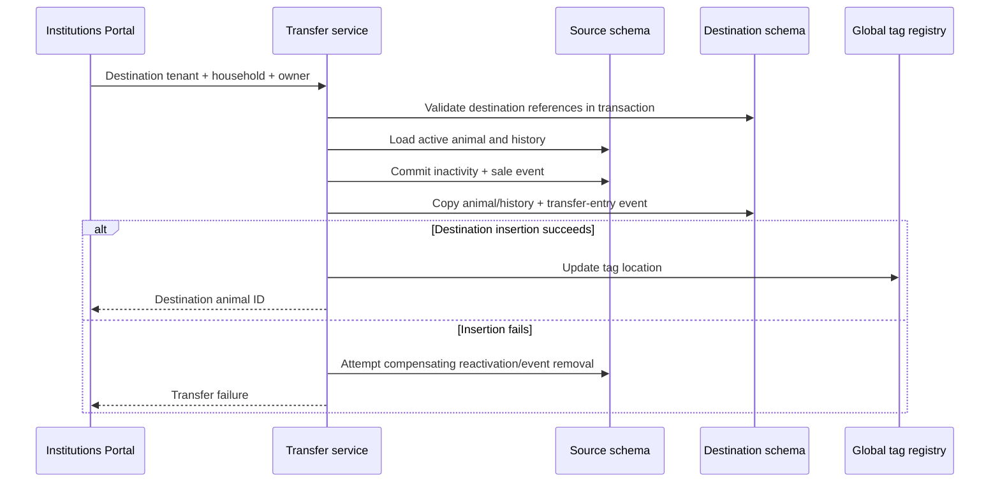

# Business workflows across the platform

[Documentation index](README.md) · [Citizens Portal](Applications/Citizens-Portal.md) · [Institutions Portal](Applications/Public-Institutions-Portal.md)

These journeys connect the actual frontend bindings, service rules, and persistence. They distinguish the two applications and identify steps that are recorded administratively rather than automatically performed by an external authority.

## Citizen application to institutional response

**Actors:** citizen in the Citizens Portal; ADMIN/USER operator in the Public Institutions Portal. **Precondition:** the selected public UAT must point to a provisioned tenant.

1. Citizen registers/logs in and selects one of eleven service cards.
2. The shared form prefills identity/address/contact from the account and captures UAT plus optional cadastral references.
3. `/api/public/cereri` resolves the global UAT's tenant; the service persists a PENDING application and tracking code, optionally linked to the citizen account.
4. A confirmation code is returned, a tenant topic is published, and synchronous confirmation email is attempted.
5. Institution application queue/panel loads the active tenant's applications. The operator inspects details and chooses ACCEPTED or DECLINED.
6. Acceptance may create a person and producer-document records; the status is saved and published to tenant, user, and application-code topics.
7. Citizen history updates; guests can use code+UAT tracking. Accepted PDFs are generated on demand after controller checks.



The server submission endpoint is public despite the guarded citizen form. The workflow lacks application attachments, clerk assignment, deadlines, rejection reasons, and a strict state-transition graph. Booklet acceptance can occur without issuance when no attestation is found; status changes can repeat acceptance side effects. PDF IDs are tenant-local and currently scanned without explicit tenant disambiguation. [Source service](../src/backend/src/main/java/com/multitenant/service/CerereService.java).

Example submission shape (synthetic documentation values):

```json
{
  "nume": "Example Applicant",
  "cnpCui": "0000000000000",
  "domiciliu": "Județ Example, Localitate Example",
  "telefon": "0700000000",
  "email": "applicant@example.invalid",
  "uatId": 1,
  "tipCerere": "ADEVERINTA_ROL",
  "numarCarteFunciara": "CF-EXAMPLE",
  "numarCadastral": "CAD-EXAMPLE"
}
```

This is a payload example, not a valid person's identity or a guaranteed seeded UAT mapping. `userId`, code, creation time, and initial status are supplied/derived by the authenticated controller/service flow; clients should not treat submitted values as an authorization grant.

## Establishing an agricultural household

**Actor:** institutional operator. **Context:** institutional JWT selects tenant; active UAT filters and preselects local records where supported.

1. Create a physical/legal person, identity documents and relationships as appropriate.
2. Create a household with code, type, address, local UAT, and activity.
3. Associate existing persons, optionally designate the head, and record dated membership events with supporting documents.
4. Create one or more land records and parcels; maintain cadastral references and land-book details.
5. Add household buildings, machinery, livestock, and documents; add parcel crops/resources/production operations.
6. Inspect history and issue a role certificate through the available household/person PDF operation.



Head assignment and membership events are separate writes; the current source does not fully enforce every mandatory-head/exit/closure requirement in historical business analysis. Land-book AFTER_COMMIT listeners run separately from the original land/parcel transaction. [Household service](../src/backend/src/main/java/com/multitenant/service/GospodarieService.java) · [land-book listener](../src/backend/src/main/java/com/multitenant/event/CarteFunciaraEventListener.java).

## Protected-space growing season

1. Operator marks the parcel as `SOLAR` or `SERA_INCALZITA` and records useful m².
2. Establish a production cycle with crop/start/status/support-program flag. A second active cycle is rejected; relevant small-area cases return a warning.
3. Register plant treatments and fertilizer applications. The backend resolves a cycle active on the operation date and rejects protected-space operations without one.
4. Treatment rules compare submitted dose units to catalog dosage and enforce justification/pause timing. Fertilization calculates N/P/K and applies implemented winter/organic-input checks.
5. Register harvests; protected-space crop name is derived from the cycle. Repeated harvests can be aggregated by year/crop/environment.
6. Finalize the cycle, setting an end date when absent. Review centralizers and available register PDFs.

Environmental temperature/humidity observations have backend endpoints restricted to protected environments, but no complete frontend entry workflow was found. The source's program/chemical thresholds are documented application rules, not a claim of up-to-date regulatory certification. [Cycle service](../src/backend/src/main/java/com/multitenant/service/CicluProductieService.java) · [harvest service](../src/backend/src/main/java/com/multitenant/service/RecoltareService.java).

## Animal transfer between tenants

**Actor:** institutional operational user. **Preconditions:** non-public source tenant, active source animal, valid destination household and owner. Source/destination IDs are local to their schemas.



The service sets/restores thread-local tenant context around transaction steps. Destination lookup is an intentional cross-tenant read capability for operational roles. Compensation can fail and global-registry updates have their own boundaries; this is not one atomic cross-schema transaction or an external veterinary registry synchronization. [Transfer source](../src/backend/src/main/java/com/multitenant/service/CrossTenantTransferService.java).

## Contract lifecycle and citizen alert

1. Operator creates a parcel-use contract with type, parties, dates, rent, and status.
2. Optional SignNow action generates/uploads a PDF and sends a signing invitation; manual polling checks remote status and stores the signed PDF/hash.
3. The scheduler enumerates tenants every minute, expires contracts with end dates before today, and selects active contracts ending before the 30-day threshold.
4. It selects a physical-person identifier from user/owner and publishes `contracte-expirare`.
5. The Kafka consumer sends `/topic/notificari/{cnp}`; a connected citizen profile appends the alert to component memory.

There is no persisted deduplication/inbox, so alerts can repeat and disconnected citizens do not receive a durable notification feed. Signing files currently use tenant-local numeric contract IDs in a shared storage directory. [Contract service](../src/backend/src/main/java/com/multitenant/service/ContractUtilizareService.java) · [scheduler](../src/backend/src/main/java/com/multitenant/service/ContractExpirationScheduler.java).

## Succession correspondence

**Actor:** institution operator; notary is recorded as correspondence metadata rather than an authenticated system role.

1. Search/select an existing physical person, enter death details if available, and enter official correspondence number/date, notary, and observations.
2. Service marks the person deceased and saves notice metadata with operator identity and copied CNP hash.
3. Kafka publication is attempted; the consumer broadcasts a general internal succession message.
4. Operator lists/searches notices by exact identifier and changes their administrative stage.
5. Person lists reflect stored death state. Legal succession adjudication and ownership transfer occur outside this implementation.

The UI's “send notification” wording does not prove that a document/email was delivered to a notary. Current frontends do not subscribe to the general succession topic. [Succession service](../src/backend/src/main/java/com/multitenant/service/NotificareSuccesiuneServiceImpl.java) · [preserved Romanian use cases and corrections](Derived/succesiuni_notificari_documentatie.md).

## Administrative tenant onboarding

Super-admin creates a tenant ID/name → backend provisions `uat_<id>` with tenant migrations → registry entry is saved → authorized administration creates tenant-associated users → a tenant admin assigns unclaimed global UATs through the tenant-UAT API → local records can be created in that schema.

The super-admin tenant detail assignment buttons currently call unmatched endpoints; the working tenant-UAT API has ADMIN-specific permissions. Activity flags do not implement a complete tenant suspension lifecycle. [Multi-tenancy lifecycle](Multi-Tenancy.md#provisioning-and-lifecycle).

## Failure and recovery behavior

| Failure | Implemented reaction |
| --- | --- |
| Application persistence/invalid UAT | Application form reports submission failure; error shape varies by controller/service |
| Confirmation email | Service catches/logs error; application is intended to remain saved |
| Kafka publish/delivery | Some immediate errors caught; no atomic outbox, durable UI replay, or complete delivery receipt |
| Remote signing | Error propagates from remote service/controller; saved state depends on stage reached |
| Tenant migration/provisioning | Best-effort schema cleanup on create; migrate-all logs tenant failure and continues |
| Animal destination insertion | Source compensation attempted; not guaranteed atomic recovery |
| Audit save | Audit error logged; original controller outcome retained |
| Missing stored file | Download returns service error/404 depending on path; database metadata alone cannot reconstruct file bytes |
