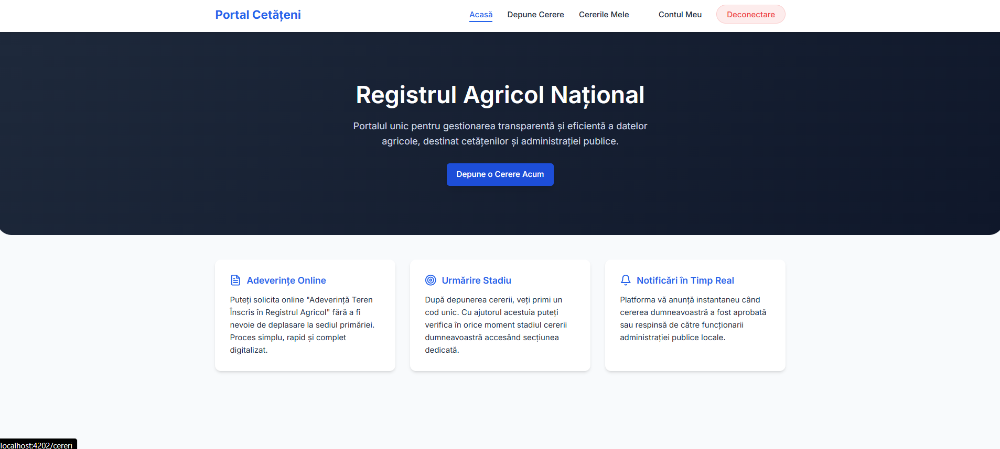
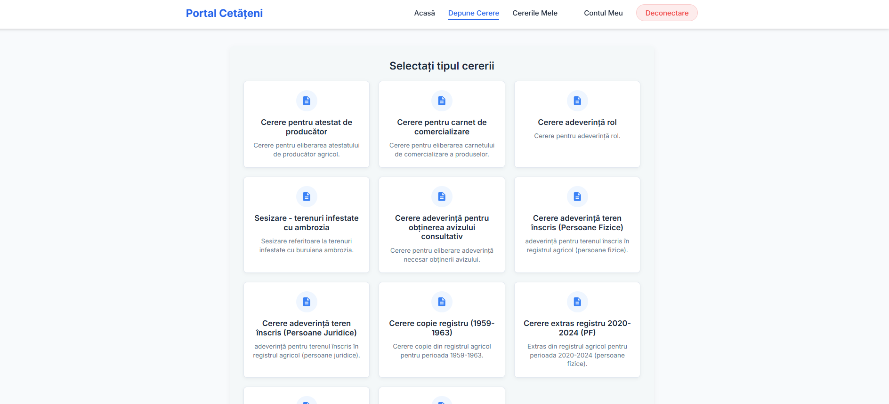
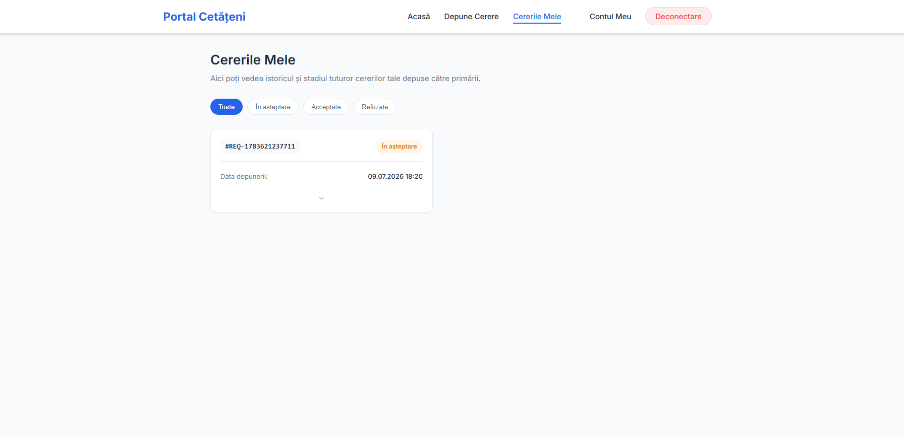
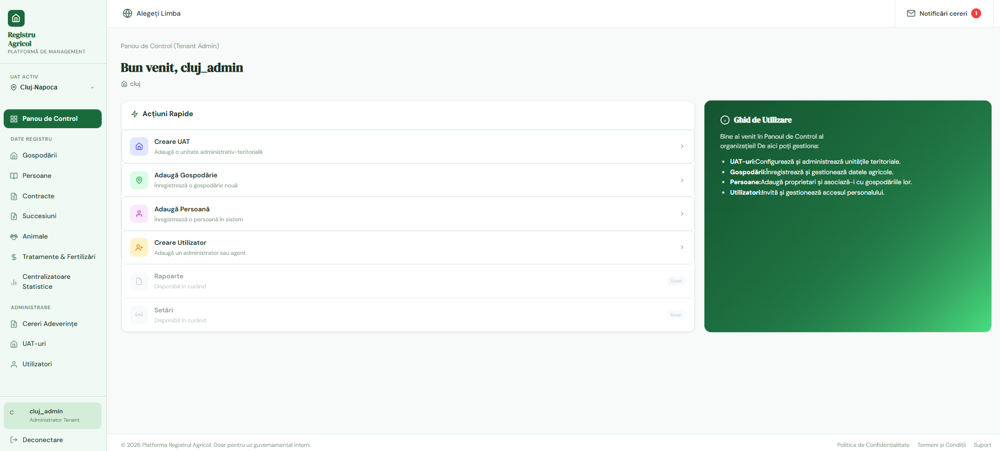
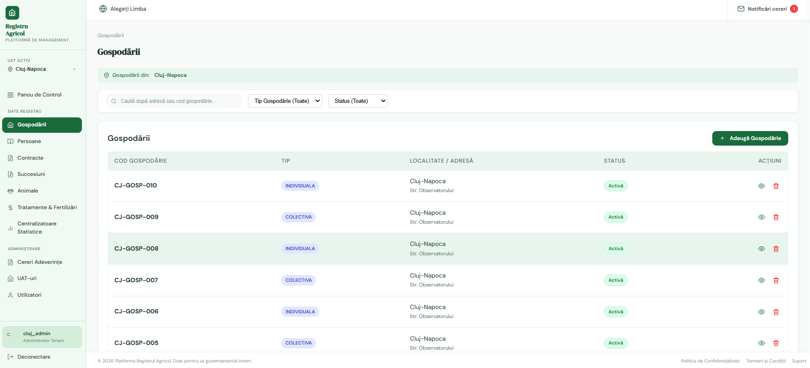
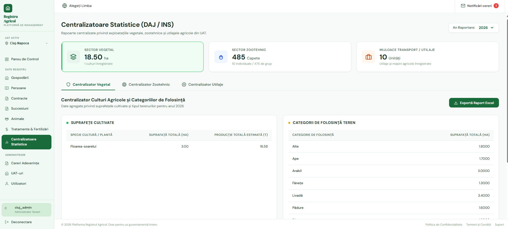
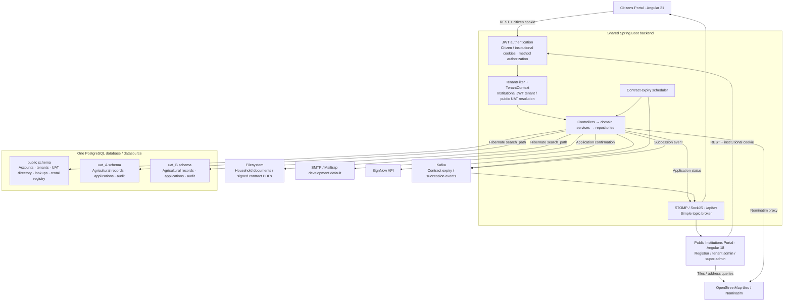

<div align="center">

# Registru-Agricol

### Agricultural records. Citizen services. Public administration.

A team-developed platform with **two independent frontend applications** and **one shared backend**, built around the Romanian agricultural register.


[Citizens Portal](#citizens-portal) · [Public Institutions Portal](#public-institutions-portal) · [Architecture](#system-architecture) · [Run locally](#getting-started) · [Documentation](Docs/README.md)

</div>

## Why this platform exists

Agricultural administration connects people, households, land, livestock, contracts, supporting documents, and public institutions. Paper registers and separate records make it difficult to follow these relationships or communicate the progress of a citizen's application.

Registru-Agricol brings these operations into a shared administrative platform. Citizens use a dedicated application to apply for certificates and track responses. Public institutions use a separate application to maintain agricultural records, process applications, and administer their users and territorial units. The backend connects these workflows and stores operational records in tenant-specific PostgreSQL schemas.

This collaborative engineering project includes implemented workflows, development seed data, and incomplete integration. The documentation describes the source and its limits. Screenshots demonstrate interface states; they do not establish production readiness or official nationwide adoption.

## Application ecosystem

| Application | Audience and responsibility | Source | Functional guide |
| --- | --- | --- | --- |
| **Citizens Portal** | Individuals and legal entities applying for public services | [`src/portal-cetateni`](src/portal-cetateni) | [Citizen features and journeys](Docs/Applications/Citizens-Portal.md) |
| **Public Institutions Portal** | Registrars, tenant administrators, and super-administrators | [`src/frontend`](src/frontend) | [Institutional modules and permissions](Docs/Applications/Public-Institutions-Portal.md) |
| **Shared backend** | APIs, business rules, tenant routing, persistence, and notifications | [`src/backend`](src/backend) | [Backend implementation](Docs/Backend.md) |

### Citizens Portal

An independent **Angular 21** application with its own entry point, routes, styles, dependencies, build, Docker image, and Nginx configuration.

- Register and sign in; maintain contact and address information.
- Discover eleven application types: agricultural certificates, producer attestations, commercialization booklets, register extracts, and ragweed reports.
- Select a county and locality/UAT, complete a application, and receive a tracking code.
- View personal applications, filter their status, inspect details, and retrieve PDFs for accepted applications.
- Track a application publicly using its code and UAT; receive live application updates and contract-expiry alerts while connected.

Citizen identity uses the `jwt_cetatean` HttpOnly cookie and the separate `public.cetateni` account table. Angular guards protect the application routes; several backend application operations remain public. [Exact authentication boundaries](Docs/Applications/Citizens-Portal.md#authentication-and-access).



<table>
<tr>
<td width="50%"><br/><sub>Administrative service catalog</sub></td>
<td width="50%"><br/><sub>Personal application tracking</sub></td>
</tr>
</table>

**Explore:** [complete application guide](Docs/Applications/Citizens-Portal.md) · [application workflow](Docs/Workflows.md#citizen-application-to-institutional-response) · [citizen screenshots](Docs/screenshots/README.md#citizens-portal)

### Public Institutions Portal

An independent **Angular 18** application for agricultural register operations and administration. Its super-administrator and tenant-administrator dashboards are role-specific sections of this application.

- Maintain persons, companies, identity documents, relationships, households, household heads, and membership events.
- Manage land, cadastral references, parcels, maps, annual crops, orchards, vineyards, pastures, forestry, water sources, buildings, and machinery.
- Track individual livestock, dated group headcounts, lifecycle events, and animal transfers between tenants.
- Record plant-protection treatments and fertilization, manage catalogs, and inspect combined parcel activity.
- Manage production cycles and harvests in open fields and protected growing spaces; environmental observations also have backend operations.
- Process citizen applications, generate documents, record succession notices, manage contracts, and initiate SignNow signing.
- View agricultural statistics, export Excel workbooks, and administer tenants, UATs, accounts, and roles.

Institutional accounts use the `jwt` HttpOnly cookie, JWT tenant claims, and Spring method authorization. The institutional route table currently has **no `canActivate` guards**; backend authorization is essential. Tenant/UAT administration also has documented integration gaps.



<table>
<tr>
<td width="50%"><br/><sub>Gospodării — agricultural households</sub></td>
<td width="50%"><br/><sub>Agricultural statistics and reporting</sub></td>
</tr>
</table>

**Explore:** [complete application guide](Docs/Applications/Public-Institutions-Portal.md) · [roles and permissions](Docs/Applications/Public-Institutions-Portal.md#roles-and-authorization) · [institutional screenshots](Docs/screenshots/README.md#public-institutions-portal)

### Shared backend

One **Java 21 / Spring Boot 3.3** service supports both applications. Controllers delegate domain operations to services and Spring Data repositories. Hibernate uses one PostgreSQL datasource: global identities and administration live in `public`, while agricultural records live in `uat_<tenantId>` schemas.

The backend implements JWT authentication, role checks, agricultural validation, citizen application decisions, PDF generation, statistical aggregation, Envers history, selected access logging, SMTP confirmation email, Kafka notifications, and STOMP/SockJS updates. SignNow and OpenStreetMap/Nominatim are integrations visible in the source. The system uses a shared backend rather than a microservice architecture.

## System architecture



Schema boundaries apply to relational records. WebSocket topics and filesystem paths do not provide equivalent isolation; public APIs resolve context from a chosen UAT. [Architecture](Docs/Architecture.md) · [multi-tenancy and limitations](Docs/Multi-Tenancy.md).

## Engineering highlights

| Aspect | How it works here |
| --- | --- |
| Independent frontends | Separate Angular workspaces and versions communicate with relative `/api` endpoints through development/Nginx proxies. |
| Schema tenancy | JWT claims populate a thread-local context; a Hibernate connection provider sets and resets PostgreSQL `search_path`. |
| Relational domain | Single-table person inheritance, many-to-many household membership, household → land → parcel hierarchy, and parcel-specific resources. |
| Citizen services | UAT selection routes applications into tenant storage; institutional decisions publish live updates and enable PDFs. |
| Livestock transfers | Explicit transactions validate the destination, deactivate the source animal, copy history, and attempt compensation on insertion failure. |
| Traceability | Envers revisions for selected entities, parcel differences, household events, and AOP access logs on annotated operations. |
| Personal identifiers | JPA AES conversion for selected CNP/CUI fields; salted SHA-256 indexes support exact searches. Other fields and logs have separate exposure limits. |
| Agricultural rules | Active-cycle checks, dose justification, harvest-pause checks, nutrient calculations, and winter/organic-nitrogen checks implemented in services. |
| Succession | Deceased-person metadata, notary correspondence records, identifier-hash search, and notice status updates. Inheritance adjudication is outside the implementation. |
| GIS | Leaflet/OSM display, custom Stereo70 conversion, GeoJSON in JSONB, and parcel history. Historical Google Maps/JTS geometry descriptions are archived. |
| Reporting | Repository projections aggregate crops, land use, livestock, and machinery; Apache POI creates `.xlsx` exports. |
| Migrations | Separate Flyway sets for global and tenant schemas, provisioning, and startup migration. |

## Technology stack

| Area | Verified implementation |
| --- | --- |
| Citizens Portal | Angular 21.2, TypeScript 5.9, standalone components, Forms, RxJS, HttpClient with Fetch |
| Public Institutions Portal | Angular 18.2, TypeScript 5.5, standalone components, reactive/dynamic forms, RxJS, Romanian/English localization |
| Backend | Java 21, Spring Boot 3.3.0, MVC, Bean Validation, ModelMapper, Lombok |
| Database and persistence | PostgreSQL 15 / PostGIS container image; JPA, Hibernate, Flyway, Envers; active geometry in JSONB |
| Authentication and authorization | Spring Security, BCrypt, JJWT 0.12.5, HttpOnly cookies, method authorization |
| Multi-tenancy | Custom Hibernate connection provider/resolver and thread-local tenant context |
| GIS and mapping | Leaflet 1.9, OSM tiles, Nominatim, custom Stereo70 → WGS84 conversion |
| Communication and notifications | Spring WebSocket, STOMP, SockJS, Spring Kafka, JavaMail, Thymeleaf |
| Reporting and documents | Apache POI 5.2.5, OpenHTMLtoPDF, OpenPDF, Thymeleaf; SignNow REST client |
| Testing | JUnit/Mockito/MockMvc, Spring Security Test, embedded PostgreSQL; institutional Jasmine/Karma and citizen Vitest |
| Infrastructure and deployment | Maven, npm lockfiles, Docker multi-stage builds, Compose, Nginx, Kafka/ZooKeeper |

## Repository structure

```text
Registru-Agricol/
├── README.md, .env.example, docker-compose.yml
├── src/
│   ├── portal-cetateni/             # Independent Citizens Portal (Angular 21)
│   │   ├── src/app/{pages,services,guards,data}/
│   │   └── Dockerfile, nginx.conf, angular.json, package.json
│   ├── frontend/                    # Independent Institutions Portal (Angular 18)
│   │   ├── src/app/{pages,components,services,models}/
│   │   ├── src/locale/              # Romanian / English translations
│   │   └── Dockerfile, nginx.conf, angular.json, package.json
│   └── backend/                     # Shared Spring Boot backend
│       ├── pom.xml, Dockerfile
│       └── src/
│           ├── main/java/com/multitenant/
│           │   ├── controller/, service/, repository/, dto/, payload/
│           │   ├── model/{core,persoana,registru,animal,audit}/
│           │   └── security/, config/tenant/, aspect/, converter/, event/
│           ├── main/resources/{db/migration,db/tenant,templates}/
│           └── test/java/com/multitenant/
├── Docs/
│   ├── Applications/                # Separate functional guides
│   ├── screenshots/                 # Separate citizen / institution galleries
│   ├── Reference/                   # API, entities, DTOs, routes, migrations
│   ├── Historical/                  # Full preserved specifications and decisions
│   └── README.md                    # Documentation map
└── uploads/                         # Runtime document storage
```

Dependency directories, caches, compiled outputs, local secrets, and runtime logs are omitted.

## Getting started

Prerequisites: Git, Docker with Compose, and a configured local `.env`. Native development additionally needs JDK 21, Maven, and Node compatible with each Angular workspace.

```powershell
# Repository root; copy only if a local .env does not already exist.
Copy-Item .env.example .env
```

Configure local database passwords, JWT/crypto values, and optional SMTP credentials. **For Compose, set `SPRING_DATASOURCE_URL=jdbc:postgresql://db:5432/multi_tenant_db`**. The example's localhost URL targets a native database and overrides the Compose default if copied unchanged.

```powershell
docker compose up --build
```

| Service | Local address |
| --- | --- |
| Citizens Portal | `http://localhost:4202/` |
| Public Institutions Portal | `http://localhost/` (redirects to `/ro/` or `/en/`) |
| Shared backend | `http://localhost:8080/` (API under `/api`) |
| Compose database from host | `localhost:5433` |

The startup seeder migrates tenants and creates demo records. It is not profile-restricted in the current source. [Development instructions](Docs/Development.md) cover environment mappings, demo accounts, native startup, storage, and troubleshooting.

For independent frontend development, use separate terminals:

```powershell
# Terminal 1: src/frontend
npm ci
npm start -- --port 4200

# Terminal 2: src/portal-cetateni
npm ci
npm start -- --port 4202
```

Run the backend from `src/backend` with `mvn spring-boot:run`. Both dev servers proxy `/api` to port 8080. Read the [configuration guide](Docs/Development.md) before using an existing database.

## Testing

```powershell
# src/backend
mvn test
# src/portal-cetateni
npm test -- --watch=false
# src/frontend
npm test -- --watch=false --browsers=ChromeHeadless
```

These are test entry points, not a claim that the suites pass. Backend tests cover selected roles, provisioning, UATs, chemical rules, auditing, and history. Frontend coverage is mostly component smoke tests. The institutional configuration references a missing `tsconfig.spec.json`; embedded PostgreSQL tests request port 5433, also used by Compose. [Testing guide](Docs/Testing.md).

## Project status and documentation

[Implementation status](Docs/Implementation-Status.md) distinguishes integrated features, backend-only operations, incomplete frontend actions, demonstration data, historical requirements, and future possibilities.

| Reader | Start here |
| --- | --- |
| Recruiter / interviewer | Showcases above, [architecture](Docs/Architecture.md), [business workflows](Docs/Workflows.md) |
| Developer / contributor | [development](Docs/Development.md), [backend](Docs/Backend.md), [API](Docs/Reference/API.md) |
| Domain / database reader | [institutional features](Docs/Applications/Public-Institutions-Portal.md), [database](Docs/Database.md), [multi-tenancy](Docs/Multi-Tenancy.md) |
| Historical research | [original Romanian specifications, branch decisions, and roadmaps](Docs/Historical/README.md) |

## Team development and attribution

Registru-Agricol was developed collaboratively as a team project. This portfolio presents the combined system and engineering work of its contributors. Existing author references, branch notes, technical decisions, and original Romanian documentation are preserved in the historical collection. Git history remains the source for commit authorship; this documentation does not assign unverified individual contributions.
